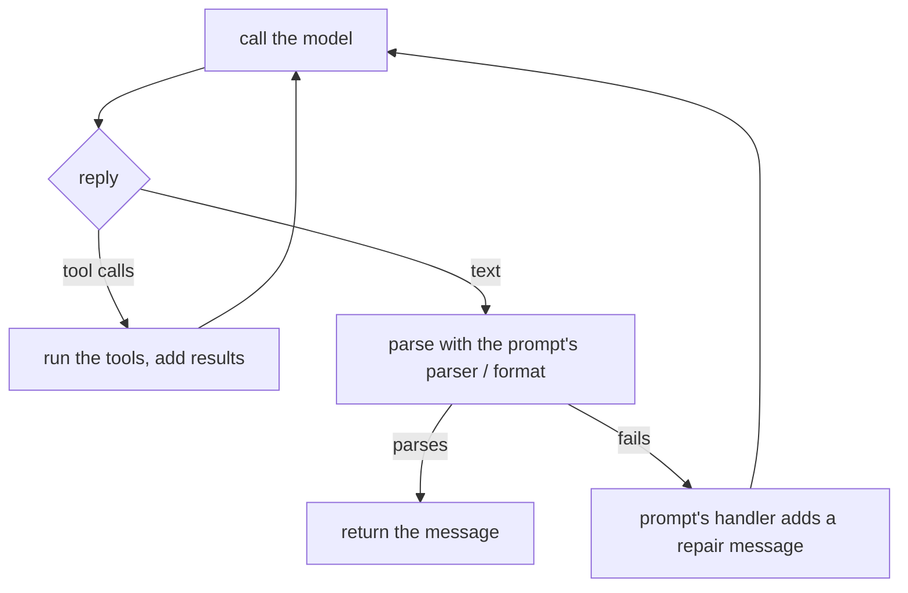

# How LLLM works

LLLM treats an agentic system as a **program**. You write ordinary Python
that decides what happens; agents are the parts of it that call models. Four
objects carry the whole design:

| Object | Role | You write | Guide |
| --- | --- | --- | --- |
| **Tactic** | The program | `call()`: the control flow | [Tactics](tactics.md) |
| **Agent** | The caller | a config: model, system prompt, limits | [Agents](agents.md) |
| **Prompt** | The function | a template, plus format, parser, tools, handlers | [Prompts](prompts.md) |
| **Dialog** | The mental state | nothing; you read, fork, and save it | [Dialogs](dialogs.md) |

Tools are typed Python functions that prompts and agents offer to the model
([Tools](tools.md)).

## One turn, step by step

An agent works on one dialog at a time. You put messages in, call
`respond()`, and the agent runs its loop until it has a final answer. Here
the prompt offers a tool, the model calls it, and the dialog records every
step:

```python title="one_turn.py"
from lllm import Prompt, Tactic, tool


@tool(description="Convert Celsius to Fahrenheit")
def to_fahrenheit(celsius: float) -> float:
    return celsius * 9 / 5 + 32


ASK = Prompt(
    path="units/ask",
    prompt="What is {celsius}°C in Fahrenheit?",
    function_list=[to_fahrenheit],
)

agent = Tactic.quick(system_prompt="You convert units.", model="gpt-4o-mini")
agent.open("chat")  # (1)!
agent.receive_prompt(ASK, {"celsius": 21})  # (2)!
reply = agent.respond()  # (3)!
print(reply.content)
#> 21°C is 69.8°F.
print(agent.current_dialog.overview())  # (4)!
"""
[0. system (developer)]: You convert units.

[1. user (user)]: What is 21°C in Fahrenheit?

[2. assistant (tool_call)]: Tool calls:

0. to_fahrenheit: {"celsius": 21}

[3. to_fahrenheit (tool)]: Return of calling function to_fahrenheit with arguments {'celsius': 21}:
---
69.8
---


[4. assistant (assistant)]: 21°C is 69.8°F.
"""
```

1. An agent can hold many dialogs, each under an alias. `open()` starts one
   with the agent's system prompt.
2. `receive_prompt()` renders the prompt with its arguments and adds it to
   the dialog. The prompt's tools are now on offer.
3. `respond()` runs the loop: the model asks for `to_fahrenheit`, the agent
   runs it, sends the result back, and the model answers.
4. The dialog is the agent's mental state: everything it saw and said, in
   order, ready to inspect, fork, or save.

## The agent loop

`respond()` is a small state machine. The prompt that is driving the turn
decides how replies are checked and what happens when they go wrong:



Each branch has a limit (`max_interrupt_steps` tool rounds,
`max_exception_retry` repairs, plus retries for provider errors), so a turn
always ends. [Agents](agents.md#the-agent-loop) has the details.

## Why a program and not a graph

A tactic's `call()` is plain Python, so the hard parts of an agentic system
are ordinary code:

```python test="skip" reason="illustration"
def call(self, claim: str) -> Verdict:
    evidence = [self.search(q) for q in self.plan(claim)]  # fan out
    verdict = self.judge(claim, evidence)
    while verdict.confidence < 0.7 and len(evidence) < 10:  # loop until sure
        evidence.append(self.search(verdict.missing))
        verdict = self.judge(claim, evidence)
    return verdict
```

You can step through it in a debugger, unit-test it with a
[fake model](testing.md), and call one tactic from another. Every call
records a session with the agents' calls, cost, and dialogs, and nested
tactic calls roll up into their caller's session.

## Configuration is declaration

Agents are described by configuration (model, system prompt, tools, limits),
not constructed by hand. A config can be a dict, as in the examples here, or
YAML files and prompts discovered from a project's `lllm.toml`, so a system's
shape lives in files you can review and swap:

```yaml
# configs/default.yaml
global:
  model_name: gpt-4o-mini
agent_configs:
  - name: researcher
    system_prompt_path: research/system
  - name: writer
    system_prompt: You write crisp briefs.
```

See [Configuration](configuration.md) and [Packages](packages.md).

## One boundary for every runtime

`lllm.Tactic` is also a typed service boundary: every tactic has `run()`,
`arun()`, streaming, and `info()` with JSON schemas. The same boundary wraps
[Pydantic AI agents](pydantic-ai.md) and [plain functions](runtimes.md), so
everything you build can be [served](serving.md), packaged, published to the
[hub](hub.md), and handed to another agent as a tool.
