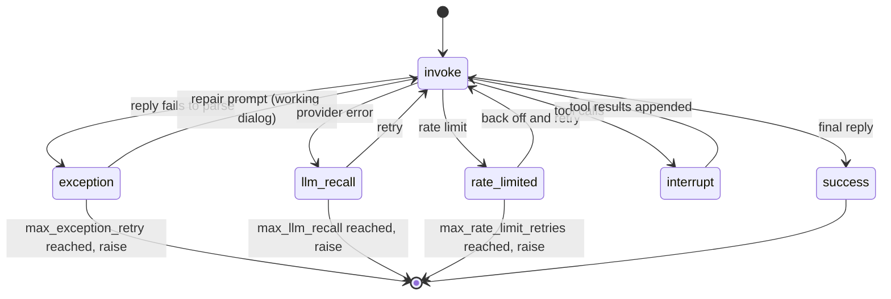

# Agent

An `Agent` is LLLM's "caller". It holds a system prompt, a model, and an
invoker, and it runs prompts through a deterministic call loop. An agent is not
a long-running process: it owns the dialogs it opens, and inside a tactic a
fresh set of agents is built for every call.

```python
agent.open("task_1", prompt_args={"topic": topic})  # create a dialog, seeded with the system prompt
agent.receive("Analyze this paper")                  # append a user turn
response = agent.respond()                           # run the call loop, return a Message
```

The point of the agent is control: each `respond()` either produces a reply
that satisfies the active prompt's contract or raises. Parsing failures, tool
calls, and provider errors are handled by explicit, bounded steps you can read
and override.

---

## Creating agents

### From configuration (inside a tactic)

Agents are usually declared in config and built by a `Tactic` that sets
`agent_group`. A config entry says which model the agent uses, which system prompt it reads, and how
its call loop behaves.

```yaml
# configs/research_writer.yaml
global:
  model_name: gpt-4o
  max_exception_retry: 3

agent_configs:
  - name: researcher
    system_prompt_path: research/researcher_system   # a registered prompt
    model_args:
      temperature: 0.3
      max_completion_tokens: 4000

  - name: writer
    system_prompt: "You write clear summaries of {topic}."   # inline prompt
    model_args:
      temperature: 0.7
```

```python
from lllm import Tactic, resolve_config


class ResearchWriter(Tactic):
    name = "research_writer"
    agent_group = ["researcher", "writer"]

    def call(self, task: str) -> str:
        researcher = self.agents["researcher"]     # a ready Agent
        ...


tactic = ResearchWriter(resolve_config("research_writer"))
```

Each `agent_configs` entry is parsed into an `AgentSpec`; `spec.build(runtime,
invoker)` produces the live `Agent`. Config errors (missing `model_name`, a
system prompt path that does not resolve) surface when the tactic is
constructed, before any model call. The full schema (`global` defaults,
`model_args` merging, `base` inheritance) is in [Configuration](config.md).

### Directly

`Agent` is a dataclass; build one yourself when you do not need a tactic.

```python
from lllm import Agent, Prompt
from lllm.runtimes.native.invokers import build_invoker

agent = Agent(
    name="writer",
    system_prompt=Prompt(path="writer/system", prompt="You write clear notes."),
    model="gpt-4o-mini",
    llm_invoker=build_invoker({"invoker": "litellm"}),
    model_args={"temperature": 0.2},
    max_interrupt_steps=3,
)

agent.open("draft")
agent.receive("Write a short project update.")
print(agent.respond().content)
```

| Field | Default | Meaning |
| --- | --- | --- |
| `name` | required | Agent name; also the `name` on its replies. |
| `system_prompt` | required | `Prompt` used to seed every dialog the agent opens. |
| `model` | required | Model id passed to the invoker (for LiteLLM: `gpt-4o`, `anthropic/claude-...`, `ollama/llama3`). |
| `llm_invoker` | required | A `BaseInvoker`. See [Invokers](invokers.md). |
| `stream_handler` | `None` | `BaseStreamHandler` that receives streamed chunks. |
| `runtime` | default runtime | Registry used to resolve prompt paths and tool refs. |
| `api_type` | `APITypes.COMPLETION` | `COMPLETION` (Chat Completions) or `RESPONSE` (OpenAI Responses API). |
| `model_args` | `{}` | Provider arguments (`temperature`, `max_tokens`, ...). |
| `max_exception_retry` | `3` | Repair attempts when the reply fails to parse. |
| `max_interrupt_steps` | `5` | Tool-call rounds per `respond()`. `0` means up to 100. |
| `max_llm_recall` | `0` | Retries after a provider error (rate limits are handled separately). |
| `max_rate_limit_retries` | `8` | Retries after rate-limit errors, with exponential backoff. |
| `context_manager` | `None` | `ContextManager` applied before each model call. See [Dialog](dialog.md#context-manager). |
| `inference_hints` | `None` | `InferenceHints` sent with each model call. See [Serving hints](#serving-hints). |

### Quick constructor

For a one-off agent without config files:

```python
from lllm import Tactic

agent = Tactic.quick(system_prompt="You are a helpful assistant.", model="gpt-4o")
agent.open("chat")
agent.receive("What is the capital of France?")
print(agent.respond().content)

reply = Tactic.quick("What is the capital of France?")              # one-shot Message
reply, agent = Tactic.quick("And of Italy?", return_agent=True)       # Message + Agent
```

`quick(query=None, system_prompt="You are a helpful assistant.", model="gpt-4o",
return_agent=False, **model_args)` returns an `Agent` named `"assistant"` when
`query` is omitted, otherwise the reply `Message` (and the agent with
`return_agent=True`). Extra keyword arguments become `model_args`.

---

## LLM call vs. agent call

| | LLM call | Agent call |
| --- | --- | --- |
| Input | A flat list of chat messages. | A `Dialog` owned by the agent, seeded with a system `Prompt`. |
| Output | Raw model text plus metadata. | A `Message`, or an `AgentCallSession` with every invocation and retry. |
| Responsibility | The caller decides whether to retry, parse, or continue. | The agent parses, repairs, runs tools, and retries within fixed budgets. |
| Determinism | Best effort. | A valid next state or an explicit exception. |

The goal of the agent call is to make an agent behave like a function: stable
inputs, a declared output contract, and bounded side effects.

---

## The call loop

`agent.respond()` runs a small state machine until it reaches a final reply.



Step by step:

1. **Resolve the contract.** The active prompt is `dialog.top_prompt` (the
   system prompt if nothing else was sent). String tool refs and bare
   `Function` declarations on it are resolved to executable tools, and the
   agent's own tools are added to it (see
   [Where tools and parsers come from](#where-tools-and-parsers-come-from)).
2. **Fork a working dialog** for this step and pass it through the
   `context_manager`, if any. The canonical dialog is never pruned or edited.
3. **Invoke.** The invoker calls the model with `model_args` (plus any per-call
   `args`) and returns an `InvokeResult`; the reply is appended to the working
   dialog.
4. **Parse failure.** If `invoke_result.has_errors`, the error is recorded and
   the prompt's handler builds a repair prompt (`on_exception`), which is
   rendered with `{error_message}` into the *working* dialog. The model is called
   again. After `max_exception_retry` failures the `AgentException` propagates.
5. **Provider error.** A rate limit (LiteLLM/OpenAI `RateLimitError`, HTTP 429,
   or a provider's "Rate limit is exceeded." / "Please wait and try again later."
   message) is retried with exponential backoff, waiting `min(60, 2**n)` seconds
   plus up to 1 s of jitter, up to `max_rate_limit_retries` times (default 8),
   then re-raised. Any other exception from the invoker counts as an LLM recall
   and is retried after 1 s, up to `max_llm_recall` times (default 0), then
   re-raised.
6. **Commit.** The valid reply is appended to the canonical dialog.
7. **Tool calls.** If the reply requests tools, each `FunctionCall` is executed
   against the prompt's `Function`s and the result is appended as a `tool`
   message through the handler's `on_interrupt` prompt (`{call_results}`). An
   identical repeated call gets a "already called, check previous results"
   message instead of running again; a tool name the prompt does not declare
   raises `KeyError`. Then the loop continues with the next step.
8. **Tool budget.** After `max_interrupt_steps` tool rounds, the handler's
   `on_interrupt_final` prompt (no tools) asks for the final answer.
9. **Success.** A plain assistant reply ends the loop; it becomes
   `session.delivery`. If the steps run out first, the session is marked
   `"failure"` and `ValueError` is raised.

Because repairs happen in a fork, the canonical dialog contains only the turns
that succeeded: system prompt, user turns, tool calls and results, and the final
reply.

### Key types

**`InvokeResult`**, returned by the invoker for each model call:

```python
@dataclass
class InvokeResult:
    raw_response: Any = None                                         # raw provider response
    model_args: Dict[str, Any] = field(default_factory=dict)         # args actually sent
    execution_errors: List[Exception] = field(default_factory=list)  # parse/validation errors
    message: Optional[Message] = None                                # the conversational message
```

Properties: `has_errors`, `error_message` (errors joined by newlines), and
`cost` (an `InvokeCost` computed from `message.usage`).

**`AgentCallSession`**, the full record of one `respond()`:

```python
class AgentCallSession(BaseModel):
    agent_name: str
    max_exception_retry: int
    max_interrupt_steps: int
    max_llm_recall: int

    exception_retries: Dict[str, List[Exception]] = {}  # parse failures, keyed by loop step
    interrupts: Dict[str, List[FunctionCall]] = {}      # tool calls per step
    llm_recalls: Dict[str, List[Exception]] = {}        # provider errors per step
    invoke_traces: Dict[str, List[InvokeResult]] = {}   # every invocation, failed ones included

    delivery: Optional[Message] = None                  # final reply on success
    state: Literal["initial", "exception", "interrupt", "llm_recall", "success", "failure"] = "initial"
```

Properties: `exception_retries_count`, `llm_recalls_count`,
`reach_max_exception_retry`, `reach_max_interrupt_steps`,
`reach_max_llm_recall`, and `cost` (summed over every invoke trace, failed
attempts included).

Handlers receive this object, so a repair strategy can depend on how many
retries happened and what failed.

---

## Where tools and parsers come from

Each turn is driven by `dialog.top_prompt`, the prompt that sent the most recent
turn. The parser, `format`, and handlers come from it:

| Call | `top_prompt` after it |
| --- | --- |
| `agent.open(alias, prompt_args)` | The agent's system prompt. |
| `agent.receive_prompt(prompt, prompt_args)` | `prompt`, with its parser, format, and handler. |
| `agent.receive(text)` | A plain prompt for that text: no parser, so the reply is free-form. |
| `agent.receive_image(image)` | Unchanged. |
| Tool results inside the loop | With the default handler, a child of the current prompt that keeps its parser. |

Tools are different: they are capabilities of the agent. The tools on the
agent's system prompt (its `function_list`, including agent-config `tools`,
proxy tools, and skills, plus MCP servers) are merged into whatever prompt
drives the turn, on **every** turn. The turn prompt can add its own tools on top
and wins on a name clash. A prompt that must be answered without the agent's
tools sets `agent_tools=False`.

```python
from lllm import Prompt
from lllm.runtimes.native import DefaultTagParser

ask = Prompt(
    path="analyst/ask",
    prompt="{question}\nAnswer inside <answer> tags.",
    parser=DefaultTagParser(xml_tags=["answer"]),
)

agent.open("main")
agent.receive("Remember: we report in USD.")          # plain turn, agent tools available
agent.respond()

agent.receive_prompt(ask, {"question": "What changed in Q3 revenue?"})
reply = agent.respond()                                # parser from `ask`, agent tools available
print(reply.parsed["xml_tags"]["answer"][0])

final = Prompt(path="analyst/final", prompt="Summarise in one line: {topic}", agent_tools=False)
agent.receive_prompt(final, {"topic": "Q3"})
agent.respond()                                        # no tools on this turn
```

---

## Interrupt and exception handling

Each `Prompt` carries a `handler` that the loop calls automatically:

- **`on_exception(prompt, session)`** runs when parsing or validation fails.
  Its prompt is rendered with `{error_message}`. Called up to
  `max_exception_retry` times, always inside the forked working dialog.
- **`on_interrupt(prompt, session)`** runs after each tool call. Its prompt is
  rendered with `{call_results}` and stays in the dialog as the `tool` message.
- **`on_interrupt_final(prompt, session)`** runs when `max_interrupt_steps` is
  reached and asks for the final reply without tools.

The default `DefaultSimpleHandler` derives each of these from the active prompt
with `prompt.extend(...)`, so repair turns keep the parser (and, except for the
final prompt, the tools). Custom handlers are covered in
[Prompts](prompts.md#handlers).

---

## `respond()` arguments

```python
agent.respond(
    alias=None,           # dialog to respond in; default: the active dialog
    metadata=None,        # attached to the reply Message's metadata, not sent to the model
    args=None,            # per-call model args merged over model_args, e.g. {"temperature": 0}
    parser_args=None,     # keyword arguments forwarded to prompt.parse(...)
    return_session=False, # True: return the AgentCallSession instead of the Message
)
```

---

## Dialog management

Agents own the dialogs they create, keyed by a user-chosen alias. The alias
makes code self-documenting and keeps dialogs from leaking between agents.

```python
agent = self.agents["coder"]

# Open a dialog: seeded with the system prompt, becomes active
agent.open("task_1", prompt_args={"language": "Python"})
agent.receive("Write a sorting function")
response = agent.respond()

# Open a second dialog, then switch back
agent.open("task_2", prompt_args={"language": "Rust"})
agent.switch("task_1")
agent.receive("Now add error handling")
response = agent.respond()

# Fork for exploration: keep the system prompt + the last 2 messages, switch to it
agent.fork("task_1", "task_1_alt", last_n=2, first_k=1, switch=True)
agent.receive("Try a different algorithm")
response = agent.respond()

old = agent.close("task_2")       # detach and return the Dialog
```

| Member | Description |
| --- | --- |
| `open(alias, prompt_args=None, session_name=None, switch=True)` | New dialog seeded with the rendered system prompt. Raises `ValueError` if the alias exists. |
| `fork(alias, child_alias, last_n=0, first_k=1, switch=True)` | Branch `alias` into `child_alias` (see [Dialog forking](dialog.md#forking)). |
| `switch(alias)` | Make `alias` active. |
| `close(alias)` | Remove the dialog and return it. |
| `receive(text, alias=None, role=Roles.USER, name="user")` | Append text. |
| `receive_prompt(prompt, prompt_args=None, alias=None, role=Roles.USER, name="user")` | Append a rendered prompt and make it the active contract. |
| `receive_image(image, caption=None, alias=None, role=Roles.USER, name="user")` | Append an image (path, base64 string, or PIL image). |
| `current_dialog` | The active `Dialog`. |
| `dialogs` | Snapshot dict of alias → `Dialog`. |
| `active_alias` | The active alias, or `None`. |

`open`, `fork`, and `switch` return the agent, so calls can be chained.

For multi-agent collaboration, each agent keeps its own dialog. Information is
shared explicitly by passing content between agents in the tactic:

```python
coder.open("collab", prompt_args={"language": "Python"})
reviewer.open("collab")

coder.receive("Write a REST API")
code = coder.respond()

reviewer.receive(code.content, name=coder.name)
review = reviewer.respond()

coder.receive(review.content, name=reviewer.name)
revision = coder.respond()
```

---

## Tools

A prompt's `function_list` declares the tools for one turn. Agents can also
receive standing tools through config: entries in `tools` are appended to the
agent's system prompt when the agent is built.

```yaml
global:
  model_name: gpt-4o
  tools:
    - shared_pkg.tools:search                # a @tool Function
    - shared_pkg.tactics:code_review         # a tactic tool
    - shared_pkg.tactics:research#summarize  # a named tactic tool method
    - shared_pkg.proxies:market_data         # a proxy (programming surface)

agent_configs:
  - name: analyst
    system_prompt_path: system/analyst

  - name: writer
    system_prompt_path: system/writer
    tools: []   # replaces the global list; writer gets none
```

Like `skills`, `tools` may be set globally or per agent, and a per-agent list
replaces the global one. The tools live on the system prompt, so they are
offered on every turn, whichever prompt drives it, unless that prompt sets
`agent_tools=False`; see
[Where tools and parsers come from](#where-tools-and-parsers-come-from).

Regular tool and tactic refs stay strings until the prompt runs, then resolve
through the runtime: full URLs (`pkg.tools:name`) are exact, while bare names
and `pkg:name` shorthand resolve relative to the system prompt's package before
the runtime's default namespace. Proxy refs must be explicit
(`pkg.proxies:name`); they are resolved when the agent is built because they
inject `query_api_doc`, `run_python`, and an API directory into the system
prompt. See [Proxies & Sandbox](proxy-and-sandbox.md).

Config stores references, not live objects, so there are no definition cycles.
Keep tool modules declarative at import time: define `@tool` functions and
`BaseProxy` classes there, and build or load any agent a tool needs inside the
tool function body.

---

## Skills

LLLM supports agent skills following the [agentskills.io](https://agentskills.io)
standard: reusable, self-contained capability folders that you attach to an
agent through config instead of baking them into the system prompt. The spec is
young and evolving, so treat this surface as experimental.

```yaml
global:
  model_name: claude-sonnet-4-6
  skills: [pdf, commit, skill_01abc, https://example.com/skills/review/SKILL.md]
```

### When to use skills

Use skills instead of system-prompt text when:

- the capability is reusable across agents or projects ("how to fill a PDF
  form", "commit message conventions");
- you want to version and share capabilities independently of prompts;
- you need provider-hosted tool grants that must be declared server-side;
- the instructions are long and only some agents need them.

Keep persona and role instructions in the system prompt, and per-call values
(user name, date) in prompt template variables.

### Entry types

Each entry in `skills` is classified by its format:

| Format | Example | Mechanism |
| --- | --- | --- |
| Local name | `pdf` | Found in the standard skill directories; catalog entry injected into the system prompt. Works with any model. |
| Anthropic skill ID | `skill_01abc123` | Sent to the API as `skills=[{"id": ...}]` with the `anthropic-beta: skills-2025-10-02` header. Anthropic models only. |
| URL | `https://example.com/skills/review/SKILL.md` | Downloaded when the agent is built; catalog entry injected. Works with any model. |
| `"*"` | `skills: "*"` | Every locally discovered skill. |

### Config examples

Same skills for all agents:

```yaml
global:
  model_name: claude-sonnet-4-6
  skills: [pdf, commit, review-pr]

agent_configs:
  - name: coder
    system_prompt_path: system/coder
  - name: reviewer
    system_prompt_path: system/reviewer
```

Per-agent override (a per-agent list **replaces** the global list):

```yaml
global:
  model_name: claude-sonnet-4-6
  skills: [commit]

agent_configs:
  - name: coder
    system_prompt_path: system/coder
    skills: [commit, pdf]

  - name: reviewer
    system_prompt_path: system/reviewer
    # inherits skills: [commit]
```

Mixed entry types:

```yaml
agent_configs:
  - name: analyst
    system_prompt_path: system/analyst
    skills:
      - data-analysis                              # local skill
      - skill_01abc123def                          # Anthropic-hosted skill
      - https://acme.com/skills/forecast/SKILL.md  # remote skill
```

### Local skill discovery

Local names are resolved by scanning these directories in order; the first match
wins, so project skills override user skills:

```
<cwd>/.agents/skills/<name>/SKILL.md
<cwd>/.claude/skills/<name>/SKILL.md
~/.agents/skills/<name>/SKILL.md
~/.claude/skills/<name>/SKILL.md
```

A missing name logs a warning and is skipped.

### Creating a local skill

A skill is a directory with a `SKILL.md`:

```
.agents/skills/
└── pdf/
    ├── SKILL.md          # frontmatter + instructions
    ├── scripts/          # optional helpers
    └── references/       # optional reference documents
```

```markdown
---
name: pdf
description: Extract PDF text, fill forms, merge files. Use when handling PDFs.
allowed-tools: computer_20250124 text_editor_20250124
---

# PDF Skill

## Extracting text

Run `scripts/extract_text.py <input.pdf>` and pipe the output to your analysis step.
```

LLLM reads three frontmatter fields:

| Field | Description |
| --- | --- |
| `name` | Skill name. Defaults to the directory name. |
| `description` | What the skill does and when to use it; the only text the model sees before activating it. |
| `allowed-tools` | Tool requirements, as a space-separated string or a YAML list. |

### How skills reach the model

When the agent is built, local and URL skills follow the agentskills.io
progressive-disclosure model.

**Tier 1: catalog.** Only names and descriptions are appended to the system
prompt, and an `activate_skill` tool is added to its `function_list`. The block
is brace-escaped, so braces in a description reach the model as written when the
prompt renders with the default `str.format` renderer:

```
<system prompt text>

When a task matches a skill's description, call the `activate_skill` tool with that skill's name to load its full instructions before proceeding.

<available_skills>
  <skill name="pdf">
    <description>Extract PDF text, fill forms, merge files. Use when handling PDFs.</description>
  </skill>
</available_skills>
```

**Tier 2: activation.** `activate_skill(name="pdf")` returns the `SKILL.md`
body, the skill directory, and a listing of bundled files:

```xml
<skill_content name="pdf">
# PDF Skill
...

Skill directory: /path/to/.agents/skills/pdf
Relative paths in this skill resolve against the skill directory.

<skill_resources>
  <file>scripts/extract_text.py</file>
</skill_resources>

Note: This skill declares tool requirements: computer_20250124 text_editor_20250124. Ensure the agent has access to these tools.
</skill_content>
```

**Tier 3: resources.** The model reads referenced files with whatever file
tools you gave it, only when the instructions call for them.

**Anthropic-hosted IDs** skip the tiers. When the agent is built, this patch is
deep-merged into its `model_args`, so it is sent on every call:

```python
{
    "skills": [{"id": "skill_01abc"}],
    "extra_headers": {"anthropic-beta": "skills-2025-10-02"},
}
```

Create hosted skills with Anthropic's Skills API, then put the returned
`skill_...` ID in the list.

### `allowed-tools`

For hosted skills, `allowed-tools` grants are applied by Anthropic. For local
and URL skills the field is informational: `activate_skill` includes a note
listing the requirements, but the agent does not receive those tools. Add them
to the agent's prompt yourself, or use a hosted skill for API-level tool grants.

### Best practices

- **Rely on progressive disclosure.** Many installed skills cost only a catalog
  line each until one is activated.
- **Write `description` as a trigger, not a title.** "Extract PDF text, fill
  forms, merge files. Use when handling PDFs." beats "PDF utilities".
- **Keep `SKILL.md` short** and move long reference material into files the
  model can load on demand.
- **Scope skills to the agents that need them.** Per-agent lists replace the
  global list.
- **Commit `.agents/skills/`** next to your prompts and configs.
- **Cache remote skills.** A tactic rebuilds its agents on every call, so URL
  skills are fetched again each time (and local directories rescanned). An
  unreachable URL logs a warning and the skill is skipped.

---

## Context management

Set `context_manager` (or `context_manager:` in config) to prune or rewrite the
working dialog before each model call; the canonical dialog keeps growing
untouched. The built-in `DefaultContextManager` truncates old messages to fit
the model's context window. See [Dialog](dialog.md#context-manager).

## Streaming

Give the agent a `BaseStreamHandler` to receive chunks while the full
`InvokeResult` is still assembled at the end:

```python
from lllm.runtimes.native.invokers.base import BaseStreamHandler


class PrintStream(BaseStreamHandler):
    def handle_chunk(self, chunk_content: str, chunk_response):
        print(chunk_content, end="", flush=True)


agent.stream_handler = PrintStream()
message = agent.respond()
```

See [Invokers](invokers.md#streaming).

## Serving hints

An agent knows things a model server cannot see from a single request: which
calls belong to the same dialog, which dialog was forked from which (a shared
prompt prefix), and how urgent a call is. `inference_hints` turns that into
request fields for serving stacks with KV-cache-aware routing and priority
scheduling:

```yaml
agent_configs:
  - name: planner
    system_prompt_path: planner/system
    inference_hints:
      profile: vllm          # "openai" (default) | "dynamo" | "vllm" | "sglang"
      priority: 5            # higher is more urgent
      session_prefix: run-42
```

```python
from lllm import InferenceHints

agent.inference_hints = InferenceHints(profile="dynamo", priority=2)
```

The session id is the dialog id being answered (prefixed with
`session_prefix`), and a forked dialog also sends its parent's id. Each profile
maps these to its own headers and body fields (`x-session-id`,
`x-dynamo-session-id`, `nvext.agent_hints`, vLLM `priority` and `cache_salt`),
merged into `model_args` as `extra_headers` / `extra_body` without overriding
values you set yourself. Servers ignore headers they do not use, so the default
`openai` profile is always safe.

[Inference Hints](inference-hints.md) covers every profile and field, the
server-side flags for Dynamo, vLLM, and SGLang, and what a server receives.

---

## Diagnostics

Pass `return_session=True` to get the full `AgentCallSession`:

```python
from lllm import Tactic


class ResearchTactic(Tactic):
    name = "research"
    agent_group = ["researcher"]

    def call(self, task: str) -> str:
        agent = self.agents["researcher"]
        agent.open("research", prompt_args={"topic": task})

        session = agent.respond(return_session=True)

        print(session.state)                          # "success"
        print(session.delivery.parsed)                # parser output
        print(session.cost)                           # tokens and dollars, all attempts
        print(session.exception_retries_count)        # repairs needed
        print(len(session.interrupts))                # tool rounds
        print(agent.current_dialog.tree_overview())   # dialog tree incl. working forks

        return session.delivery.content
```

Inside a tactic, every `respond()` is also recorded on the tactic's
`TacticCallSession`; see [Tactics](tactic.md#session-tracking).
