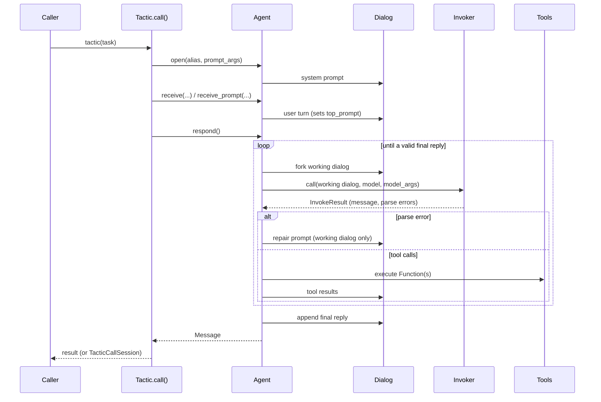
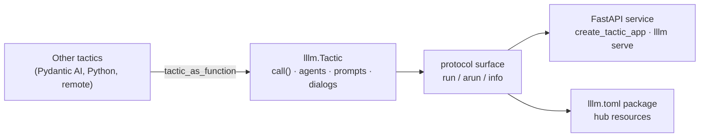

# Architecture

LLLM stands for **Low-Level Language Model**. At its core is a small, readable
framework for building advanced agentic systems: program synthesis loops,
neuro-symbolic pipelines, multi-agent research systems, anything where you need
to see and steer every turn an agent takes. That framework is the native runtime,
`lllm.runtimes.native`.

"Low-level" here means control and transparency. It does not mean boilerplate.

- **Every turn is a declared contract.** A `Prompt` bundles the template, the
  parser that defines a valid reply, the tools the model may call, and the
  handlers that decide what to say when parsing fails or a tool returns.
- **The loop that enforces it is short enough to read.** `Agent.respond()` calls
  the model, parses the reply, runs tools, and routes failures through your
  handlers, with explicit retry caps.
- **State is explicit.** Each agent's conversation is a `Dialog`, a tree you can
  fork, inspect, serialize, and replay.
- **Everything is typed with Pydantic:** prompts, messages, call sessions, and
  tactic inputs and outputs.
- **It comes with research tooling:** an in-process Python interpreter and a
  Jupyter sandbox for agents that run code, proxies for agents that need many
  API endpoints, agent skills, and access to 100+ model providers through LiteLLM.

```bash
pip install "lllm-core[native]"     # LiteLLM-backed agents
pip install "lllm-core[sandbox]"    # optional Jupyter sandbox
```

---

## The four abstractions

LLLM organises an agentic system into four layers, each with a single
responsibility.

```
┌──────────────────────────────────────────────────┐
│                    Tactic                        │  ← "the program"
│  (orchestrates agents, owns the task interface)  │
├────────────────┬────────────────┬────────────────┤
│    Agent A     │    Agent B     │    Agent C     │  ← "the callers"
│  (model+loop)  │  (model+loop)  │  (model+loop)  │
├────────────────┴────────────────┴────────────────┤
│               Prompts (functions)                │  ← "the calls"
│  template · parser · tools · handlers            │
├──────────────────────────────────────────────────┤
│               Dialogs (state)                    │  ← "mental state"
│  per-agent message history, fork-able tree       │
└──────────────────────────────────────────────────┘
```

| Abstraction | Role | Class |
| --- | --- | --- |
| Tactic | The program. Takes a task, wires agents together, returns a result. | `Tactic` (set `agent_group` to get agents) |
| Agent | The caller. A system prompt, a model, and the call loop. | `Agent` |
| Prompt | The function. One turn's template, output contract, tools, and handlers. | `Prompt` |
| Dialog | The agent's mental state. Append-only messages in a fork-able tree. | `Dialog` |

All four import from the top-level package:

```python
from lllm import Agent, Dialog, Prompt, Tactic, tool
```

`lllm` exports the native vocabulary (`Tactic`, `Prompt`, `Agent`, `Dialog`,
`Message`, `Function`, `tool`, `tactictool`, `Runtime`, `load_runtime`,
`resolve_config`, `build_tactic`, `BaseProxy`, ...). `lllm.runtimes.native`
holds the same objects plus the parser and handler classes
(`DefaultTagParser`, `BaseParser`, `BaseHandler`, `DefaultSimpleHandler`, ...);
import those from there, because `lllm.DefaultTagParser` is the
runtime-agnostic parser, whose tags are optional.

`lllm.Tactic` is also LLLM's protocol tactic: the same class you serve,
package, and compose with other runtimes. See
[How native fits into the rest of LLLM](#how-native-fits-into-the-rest-of-lllm).

---

## Design ideas

### An agentic system is a program

A tactic's `call()` is ordinary Python. Agents are called like functions, and
the control flow (sequencing, branching, loops, parallelism) is code you
write and can debug.

```python
from lllm import Tactic


class DraftAndReview(Tactic):
    name = "draft_and_review"
    agent_group = ["writer", "reviewer"]

    def call(self, task: str) -> str:
        writer, reviewer = self.agents["writer"], self.agents["reviewer"]

        writer.open("draft", prompt_args={"topic": task})
        draft = writer.respond().content

        reviewer.open("review")
        reviewer.receive(draft, name="writer")
        return reviewer.respond().content


config = {
    "global": {"model_name": "gpt-4o-mini"},
    "agent_configs": [
        {"name": "writer", "system_prompt": "Write a one-paragraph brief about {topic}."},
        {"name": "reviewer", "system_prompt": "Tighten the draft you receive."},
    ],
}

tactic = DraftAndReview(config)
session = tactic("dialog trees", return_session=True)
print(session.delivery)
print(session.summary())          # agent calls, cost, state
```

**Why it matters.** A tactic is stateless: every call gets fresh agents and
fresh dialogs, so concurrent calls (`tactic.bcall(tasks)`) never share mutable
state. Each call returns or records a `TacticCallSession` with every agent call
and its cost. See [Tactics](tactic.md).

### A prompt is a function signature

The agent is the function and the `Prompt` is its type signature. The invoker
reads the parser, output format, and handlers from the prompt that sent the
latest turn, and the agent loop keeps going until the reply satisfies it. Plain
text sent with `agent.receive()` has no parser; send a `Prompt` with
`agent.receive_prompt()` when the turn needs a contract. Tools combine: the
agent's own tools (those on its system prompt) are offered on every turn,
alongside the turn prompt's.

```python
from lllm import Prompt, tool
from lllm.runtimes.native import DefaultTagParser


@tool(description="Evaluate an arithmetic expression", prop_desc={"expr": "e.g. 2*(3+4)"})
def calc(expr: str) -> str:
    return str(eval(expr, {"__builtins__": {}}))   # demo only


solve = Prompt(
    path="math/solve",
    prompt="Solve: {question}\nShow work in <work> and the result in <answer>.",
    parser=DefaultTagParser(xml_tags=["work", "answer"]),
    function_list=[calc],
)

print(solve(question="What is 17 * 23?"))
print(solve.parse("<work>17*23</work><answer>391</answer>")["xml_tags"]["answer"])
```

With an agent, the same prompt becomes one validated call:

```python
agent.open("main")
agent.receive_prompt(solve, {"question": "What is 17 * 23?"})
reply = agent.respond()                      # tool calls and repairs happen inside
answer = reply.parsed["xml_tags"]["answer"][0]
```

**Why it matters.** Parse failures become repair turns
(`"Error: {error_message}. Please fix."` by default) in a *forked* working
dialog, so the canonical history only records the valid reply. Retries are
capped (`max_exception_retry`), and failure surfaces as an exception rather
than a silently malformed answer. The handler is a replaceable object, so the
repair strategy is yours. See [Prompts](prompts.md) and [Agent](agent.md).

### A dialog is the agent's mental state

A dialog is what one agent has seen: not a shared global chat log. Agents
share information only by passing content explicitly. Dialogs are append-only
and fork into trees.

```python
from lllm import Dialog, Prompt, Role

system = Prompt(path="planner/system", prompt="You are a {style} planner.")

dialog = Dialog(owner="planner")
dialog.put_prompt(system, {"style": "careful"}, role=Role.SYSTEM, name="system")
dialog.put_text("Plan the next release.", name="user")

branch = dialog.fork(last_n=1, first_k=1)    # keep system prompt + last message
branch.put_text("Assume the deadline moved up a week.", name="user")

print(dialog.tree_overview())
print(branch.parent is dialog, len(branch.messages))
```

**Why it matters.** Forking gives you speculation, alternative strategies, and
context-window management without mutating history. Every dialog carries a
`DialogTreeNode` (ids and split points only), so the full tree can be
reconstructed from logs. The agent loop itself forks a working dialog at
every step of a call. See [Dialog](dialog.md).

### Configuration is declaration

What exists (prompts, tools, proxies, tactics, configs) is declared in an
`lllm.toml` package; how agents are wired is declared in YAML. Python code
refers to resources by namespaced URL instead of import paths.

```toml
# lllm.toml
[package]
name = "research_kit"

[prompts]
paths = ["prompts"]

[tactics]
paths = ["tactics"]

# tools/, proxies/, configs/, assets/ are discovered by default when present
```

```yaml
# configs/default.yaml
tactic_type: draft_and_review
global:
  model_name: gpt-4o-mini
  tools: [research_kit.tools:search]
agent_configs:
  - name: writer
    system_prompt_path: research_kit:briefs/writer
  - name: reviewer
    system_prompt_path: research_kit:briefs/reviewer
```

```python
from lllm import build_tactic, load_runtime, resolve_config

load_runtime()                                   # discover ./lllm.toml
tactic = build_tactic(resolve_config("default"))
```

`lllm create my-app` generates exactly this shape: `lllm.toml`, `prompts/`,
`configs/default.yaml`, `tactics/`, a `main.py`, and an offline smoke test.

**Why it matters.** The system's shape is inspectable, diffable, and
reproducible; swapping a model or prompt is a config change. Packages are
namespaced (`research_kit.prompts:briefs/writer`), so you can depend on other
people's prompts and tactics like libraries. Because configs hold references,
not live objects, tool modules never have to build agents at import time.
See [Configuration](config.md) and [Package Discovery](../packages/discovery.md).

### Declaring a tool is separate from implementing it

A prompt can carry a bare `Function` declaration, a header that tells the model
what it may call. The implementation is a normal `@tool` function in the same
package. At run time LLLM binds them by exact name.

```python
# prompts/notes.py: what the model sees
from lllm import Function, Prompt

save_note = Function(
    name="save_note",
    description="Save a research note.",
    properties={"title": {"type": "string"}, "content": {"type": "string"}},
    required=["title", "content"],
)
system = Prompt(path="system", prompt="Take notes as you go.", function_list=[save_note])
```

```python
# tools/save_note.py: how it runs
from lllm import tool


@tool(name="save_note", description="Save a research note.")
def save_note(title: str, content: str) -> str:
    ...
    return f"saved {title!r}"
```

**Why it matters.** Prompts stay declarative and versionable as interfaces;
implementations stay testable Python. A name mismatch fails loudly instead of
silently binding the wrong callable. When declaration and implementation belong
together, pass the `@tool` function directly instead. See
[Prompts](prompts.md#defining-tools).

### Tactics are tools: the recursive abstraction graph

A tactic is the top of the stack, yet a prompt can call one. Decorate a tactic
method with `@tactictool` and reference the tactic by URL in a
`function_list`; one model turn can then invoke a whole agentic subsystem.

```python
from pydantic import BaseModel
from lllm import Prompt, Tactic, tactictool


class CodeInput(BaseModel):
    code: str


class CodeReview(Tactic):
    """Review code and list concrete issues."""
    name = "code_review"
    agent_group = ["reviewer"]

    @tactictool("code_review", config="shared_pkg:review")
    def call(self, task: CodeInput) -> str:
        reviewer = self.agents["reviewer"]
        reviewer.open("review")
        reviewer.receive(task.code)
        return reviewer.respond().content


planner = Prompt(
    path="planner/system",
    prompt="Plan the change. Request a code review before finishing.",
    function_list=["shared_pkg.tactics:code_review"],
)
```

**Why it matters.** Reusable capabilities ship as tactics, and any agent can
use them as tools without knowing how many agents or prompts sit inside. The
`CodeInput` model becomes the tool's JSON schema. See
[Tactics](tactic.md#tactics-as-tools).

### Tool calling as programming: proxies

When an agent needs dozens of related endpoints, one function schema per
endpoint does not scale. A proxy exposes an API surface as a *programming*
environment: the agent reads endpoint docs with `query_api_doc` and writes
Python that calls `CALL_API(...)` through `run_python`, keeping variables
between calls.

```python
import os

from lllm import BaseProxy, ProxyRegistrator


@ProxyRegistrator(path="weather", name="Weather API", description="Current conditions.")
class WeatherProxy(BaseProxy):
    base_url = "https://api.example.com/v1"   # requests go to <base_url>/<endpoint>
    api_key_name = "appid"                    # the key is sent as ?appid=<api_key>
    api_key = os.getenv("WEATHER_API_KEY")

    @BaseProxy.endpoint(
        category="current",
        endpoint="current",
        description="Current temperature for a city.",
        params={"city*": (str, "Paris")},
        response={"city": "Paris", "temp": 21.5},
    )
    def current(self, params: dict) -> dict:
        return params          # shape or validate the request parameters here
```

The agent writes `CALL_API("weather/current", {"city": "Oslo"})` inside
`run_python`, and LLLM sends `GET https://api.example.com/v1/current?city=Oslo&appid=...`.

```yaml
agent_configs:
  - name: analyst
    system_prompt_path: analyst/system
    tools: [my_pkg.proxies:weather]    # injects query_api_doc + run_python
```

**Why it matters.** The model composes calls, filters results, and computes
with Python instead of shuttling raw JSON through the context window. See
[Proxies & Sandbox](proxy-and-sandbox.md).

---

## Composing with Pydantic

Pydantic is the type system across the native runtime.

**Typed tactic inputs and outputs.** Set `input_type` and `output_type` (or
`input_model` / `output_model`). The tactic validates every call, so dicts are
coerced into models, and `tactic.info()` exports both JSON schemas.

```python
from pydantic import BaseModel
from lllm import Tactic


class BriefIn(BaseModel):
    topic: str
    audience: str = "engineers"


class BriefOut(BaseModel):
    title: str


class Brief(Tactic):
    name = "brief"
    input_type = BriefIn
    output_type = BriefOut

    def call(self, task: BriefIn) -> BriefOut:
        return BriefOut(title=f"{task.topic} for {task.audience}")


print(Brief()({"topic": "Dialogs"}))                      # dict -> BriefIn
print(Brief().info().input_schema["required"])            # ['topic']
```

**Structured output.** `Prompt(format=MyModel)` asks the provider for JSON that
matches the model (Chat Completions API). The reply's `message.parsed` holds the
decoded dict:

```python
class Report(BaseModel):
    title: str
    sources: list[str]


report_prompt = Prompt(path="report", prompt="Report on {topic}.", format=Report)

agent.open("main")
agent.receive_prompt(report_prompt, {"topic": "dialog trees"})
report = Report.model_validate(agent.respond().parsed)
```

**Validation with repair.** A parser can validate with Pydantic and raise
`ParseError`; the agent loop then sends Pydantic's error message back to the
model and asks for a fix, up to `max_exception_retry` times.

```python
from pydantic import BaseModel, Field, ValidationError
from lllm import Prompt
from lllm.runtimes.native import BaseParser, ParseError, find_md_blocks


class Verdict(BaseModel):
    label: str = Field(pattern="^(approve|reject)$")
    confidence: float = Field(ge=0, le=1)


class ModelParser(BaseParser):
    """Validate a ```json block against a Pydantic model."""

    def __init__(self, model: type[BaseModel]):
        self.model = model

    def parse(self, content: str, **runtime_args) -> dict:
        blocks = find_md_blocks(content, "json")
        if not blocks:
            raise ParseError("Reply with one ```json block.")
        try:
            return {"value": self.model.model_validate_json(blocks[0])}
        except ValidationError as exc:
            raise ParseError(f"The JSON does not match the schema:\n{exc}")


review = Prompt(
    path="review/verdict",
    prompt="Review this diff:\n{diff}\nReply with a ```json block matching {schema}.",
    parser=ModelParser(Verdict),
)
print(review.parse('```json\n{"label": "approve", "confidence": 0.9}\n```')["value"])
```

**Typed tactic tools.** A `@tactictool` method whose parameter is a
`BaseModel` uses that model as the tool's JSON schema, and a `BaseModel` return
value is sent back to the calling model as JSON.

---

## Data flow



---

## How native fits into the rest of LLLM

The native runtime is where agents are built. The rest of LLLM is the outer
interface that lets a native system be served, packaged, and mixed with other
runtimes, and a native tactic plugs into it directly: `lllm.Tactic` is both the
program class and the protocol tactic.



- **Protocol.** Every tactic has validated `run()` / `arun()`, accepts a
  `CallContext` (passed to `call(context=...)` when `call` takes it), and
  describes itself with `info()`; `runtime_kind` is `"native"` for tactics that
  write `call()`. See [Tactics](tactic.md#serving-and-the-protocol) and
  [Tactic protocol](../protocol/tactic.md).
- **Services.** Pass the tactic to `lllm.create_tactic_app`, or point
  `lllm serve` at it or at a factory that builds it
  (`lllm serve my_pkg.tactics:build`; see
  [Factories and handlers](tactic.md#factories-and-handlers)). See
  [Services](../protocol/services.md).
- **Packages.** The same `lllm.toml` that drives native discovery also carries
  hub metadata. See [Package Manifest](../packages/manifest.md) and
  [Hub](../packages/hub.md).
- **Other runtimes.** `tactic_as_function(tactic)` turns any protocol tactic
  into a native `Function` a prompt can call; `tactic.as_tool()` turns a
  tactic into a plain Python callable for other agent frameworks.
  `NativeTacticAdapter` remains for objects that only look like tactics (a class
  with `call()` or `run()` that does not subclass `Tactic`).

---

## Where to go next

- [Agent](agent.md): the call loop, dialogs by alias, tools, skills
- [Prompts](prompts.md): templates, parsers, tools, handlers
- [Dialog](dialog.md): messages, forking, context management
- [Tactics](tactic.md): orchestration, sessions, tactic tools, serving
- [Configuration](config.md): `lllm.toml` and YAML agent configs
- [Invokers](invokers.md): providers, streaming, custom invokers
- [Logging](logging.md): sessions, observers, terminal logs
- [Runtime & Registries](runtime.md) and [Package Discovery](../packages/discovery.md)
- [Tutorials](../tutorials/index.md)
