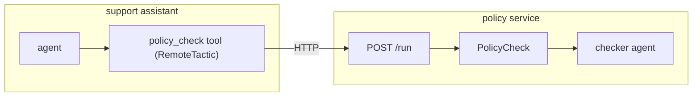

# A shared service over HTTP

One team owns a policy check: a tactic that decides whether a message is
safe to send. They serve it over HTTP, and other teams' agents call it as a
tool through `RemoteTactic`, without importing the policy team's code or
knowing which models it uses. Each side can change and redeploy on its own
schedule; the typed contract is all they share.



## The program

To run in one file, this example starts the service in a background
thread. In production the two halves run in separate processes, as shown
after the code.

```python title="shared_service.py"
import socket
import threading
import time
from typing import Literal

import uvicorn
from pydantic import BaseModel

from lllm import Prompt, RemoteTactic, Tactic, create_tactic_app
from lllm.runtimes.native import tactic_as_function


class Draft(BaseModel):  # (1)!
    text: str
    channel: Literal["email", "chat", "public"] = "email"


class Verdict(BaseModel):
    allowed: bool
    problems: list[str]


# The service, owned by the policy team.

CHECK = Prompt(
    path="policy/check",
    prompt="Check this {channel} message against the data policy.\n"
    "Policy: no internal links, no other customers' data, no secrets.\n"
    "Message:\n{text}",
    format=Verdict,
)


class PolicyCheck(Tactic):
    """Check a message against the data policy."""

    name = "policy_check"
    agent_group = ["checker"]
    input_model = Draft
    output_model = Verdict

    def call(self, draft: Draft) -> Verdict:
        checker = self.agents["checker"]
        checker.open("check")
        checker.receive_prompt(CHECK, draft.model_dump())
        return checker.respond().parsed


policy_check = PolicyCheck(
    {
        "global": {"model_name": "gpt-4o-mini"},
        "agent_configs": [
            {"name": "checker", "system_prompt": "You enforce the policy."}
        ],
    }
)


def serve_in_background(app):  # (2)!
    with socket.socket() as probe:
        probe.bind(("127.0.0.1", 0))
        port = probe.getsockname()[1]
    config = uvicorn.Config(app, port=port, log_level="warning")
    server = uvicorn.Server(config)
    threading.Thread(target=server.run, daemon=True).start()
    while not server.started:
        time.sleep(0.05)
    return server, f"http://127.0.0.1:{port}"


server, url = serve_in_background(create_tactic_app(policy_check))

# The client, a support assistant owned by another team.

policy = RemoteTactic(  # (3)!
    url, name="policy_check", input_type=Draft, output_type=Verdict
)
contract = policy.fetch_info()  # (4)!
print(contract.name, "|", contract.description)
#> policy_check | Check a message against the data policy.

check = tactic_as_function(  # (5)!
    policy, description=contract.description, parameter_mode="kwargs"
)
REPLY = Prompt(
    path="support/reply",
    prompt="Answer this customer email: {question}\nFacts: {facts}\n"
    "Check your answer with policy_check before you send it.",
    function_list=[check],
)

assistant = Tactic.quick(
    system_prompt="You are a support agent.", model="gpt-4o-mini"
)
assistant.open("reply")
question = "Is my data export ready?"
facts = "Export EXP-88 finished. Admin link: https://admin.internal/exp/88"
assistant.receive_prompt(REPLY, {"question": question, "facts": facts})
session = assistant.respond(return_session=True)
for call in session.tool_calls:  # (6)!
    print(call.result)
    #> allowed=False problems=['Links to an internal admin page.']
    #> allowed=True problems=[]
print(session.delivery.content)
#> Your export is ready. Download it from Settings > Exports.

server.should_exit = True
```

1. The models are the contract. Both sides import them, typically from a
   small shared package; the client never imports the service's tactic.
2. Only for this example: it runs the service on a free local port. In
   production, `lllm serve` runs it (see below).
3. A `RemoteTactic` is a tactic whose work happens behind a URL. With
   `input_type` and `output_type`, it validates the input before sending
   and returns a `Verdict`, not raw JSON.
4. `fetch_info()` reads the service's `/info`: its name, description,
   schemas, and capabilities.
5. The remote tactic becomes a tool like any other. With
   `parameter_mode="kwargs"`, the tool's parameters are the fields of
   `Draft`.
6. The assistant's first answer leaked an internal link, the policy service
   rejected it, and the second answer passed.

## Running it as two processes

Split the file at the comments. The policy team serves their half, which
defines `policy_check`, with `lllm serve`:

```bash
lllm serve policy_service:policy_check --host 0.0.0.0 --port 8100
```

The support team's code is the client half with one change: the URL of the
running service instead of the background thread.

```python test="skip" reason="needs the policy service running"
policy = RemoteTactic(
    "http://policy.internal:8100",
    name="policy_check",
    input_type=Draft,
    output_type=Verdict,
)
```

Nothing else changes. Requests and replies use the envelope every served
tactic uses: `{"input": ..., "context": ...}` in, `{"output": ...,
"request_id": ..., "tactic": ...}` out ([Serving](../serving.md)).

## How it works

**The contract is the code.** `Draft` and `Verdict` are the request and
response schemas. The service validates every request against `Draft`
before `call()` runs, the client validates before sending, and `/info` and
the OpenAPI docs publish both, so the two sides cannot drift apart without
someone noticing.

**Remote and local look the same.** `RemoteTactic` has `run()`, `arun()`,
streaming, and `info()` like any tactic, so `tactic_as_function()` turns it
into a tool with no glue code. Moving a tactic behind a service changes one
line in its callers.

**Failures are tool errors.** If the service is down or rejects a request,
`policy.run()` raises, and the agent loop hands the model
`Error: <message>` as the tool's result, as it does for any tool. The
assistant can retry, or say it cannot check its answer yet.

**Each side owns its models.** The policy team can change the checker's
model, prompt, or the whole implementation without a release from anyone
else, as long as `Draft` and `Verdict` stay compatible.

## Make it yours

- Call `policy.run(draft, context=CallContext(trace_id=...))` directly, and
  the ids travel with the request: a service `call()` that accepts
  `context` receives them, so logs on both sides line up.
- Serve several tactics from one app with `create_service_app()`, and point
  each `RemoteTactic` at `http://host:8100/tactics/<name>`.
- Package the service with an `lllm.toml` so `lllm serve ./policy` checks
  its API keys before starting ([Packages](../packages.md)).
- Give the tool to a [Pydantic AI](../pydantic-ai.md) agent instead:
  `tactic_as_tool(policy)` returns a typed function.
