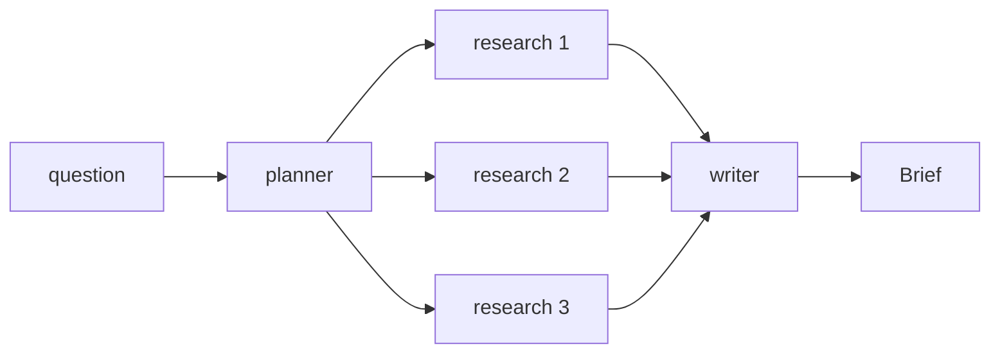

# Research brief

A research assistant that answers questions from a team's incident reports.
A planner splits the question, researchers search the reports in parallel,
and a writer turns their findings into a typed brief that cites its
sources. It shows the pattern most research systems share: plan, fan out,
gather, and write, with each step's output checked before the next step
uses it.



## The program

```python title="research_brief.py"
from pydantic import BaseModel

from lllm import Prompt, Tactic, tool

REPORTS = {
    "INC-101": "Deploys failed when database migrations ran past the "
    "five-minute deploy timeout. Fix: long migrations now run before the "
    "deploy starts.",
    "INC-102": "A stale cache key served old pages after the March "
    "release. Fix: cache keys include the release version.",
    "INC-103": "Deploys failed when two pipelines raced for the same lock. "
    "Fix: deploys are queued per service.",
    "INC-104": "After the migration and queueing fixes, the deploy failure "
    "rate fell from 9% in Q1 to 2% in Q2.",
}


@tool(description="Search the incident reports for keywords")
def search_reports(keywords: list[str]) -> str:  # (1)!
    def score(report_id: str) -> int:
        text = REPORTS[report_id].lower()
        return sum(word.lower() in text for word in keywords)

    ranked = sorted(REPORTS, key=score, reverse=True)
    hits = [f"{rid}: {REPORTS[rid]}" for rid in ranked[:2] if score(rid)]
    return "\n".join(hits) or "No matching reports."


class Plan(BaseModel):
    questions: list[str]


class Finding(BaseModel):
    question: str
    answer: str
    sources: list[str]


class Brief(BaseModel):
    title: str
    points: list[str]
    sources: list[str]


PLAN = Prompt(
    path="brief/plan",
    prompt="Break this question into three research questions: {question}",
    format=Plan,
)
RESEARCH = Prompt(
    path="brief/research",
    prompt="Research this question in the incident reports: {question}\n"
    "Answer from the reports and cite their ids.",
    format=Finding,
    function_list=[search_reports],
)
WRITE = Prompt(
    path="brief/write",
    prompt="Write a brief that answers: {question}\nFindings:\n{findings}",
    format=Brief,
)


class Research(Tactic):  # (2)!
    name = "research"
    agent_group = ["researcher"]
    output_model = Finding

    def call(self, question: str) -> Finding:
        researcher = self.agents["researcher"]
        researcher.open("research")
        researcher.receive_prompt(RESEARCH, {"question": question})
        return researcher.respond().parsed


class ResearchBrief(Tactic):
    name = "research_brief"
    agent_group = ["planner", "writer"]
    output_model = Brief

    def __init__(self, config):
        super().__init__(config)
        self.research = Research(config)  # (3)!

    def call(self, question: str) -> Brief:
        planner = self.agents["planner"]
        planner.open("plan")
        planner.receive_prompt(PLAN, {"question": question})
        plan = Plan.model_validate(planner.respond().parsed)

        findings = self.research.bcall(plan.questions)  # (4)!

        writer = self.agents["writer"]
        writer.open("write")
        notes = "\n".join(finding.model_dump_json() for finding in findings)
        args = {"question": question, "findings": notes}
        writer.receive_prompt(WRITE, args)
        return writer.respond().parsed


config = {
    "global": {"model_name": "gpt-4o-mini"},
    "agent_configs": [
        {"name": "planner", "system_prompt": "You plan research."},
        {"name": "researcher", "system_prompt": "You answer from sources."},
        {"name": "writer", "system_prompt": "You write short briefs."},
    ],
}
research_brief = ResearchBrief(config)

if __name__ == "__main__":
    question = "Why did deploys fail last quarter, and what fixed it?"
    session = research_brief(question, return_session=True)  # (5)!
    brief = session.delivery
    print(brief.title)
    #> Why deploys failed last quarter
    print("\n".join(f"- {point}" for point in brief.points))
    """
    - Migrations outran the five-minute deploy timeout (INC-101).
    - Two pipelines raced for the same deploy lock (INC-103).
    - Migrations now run before deploys; deploys queue per service.
    - Failures fell from 9% in Q1 to 2% in Q2 (INC-104).
    """
    print("Sources:", ", ".join(brief.sources))
    #> Sources: INC-101, INC-103, INC-104
    assert set(brief.sources) <= set(REPORTS)  # (6)!

    agents = session.agent_call_count
    research = session.sub_tactic_call_count
    print(f"{agents} agent calls, {research} research calls")
    #> 2 agent calls, 3 research calls
```

1. The tool is ordinary Python. Swap the dictionary for your search API or
   vector index; the agents do not change.
2. Research is a tactic of its own, so each question gets a fresh agent
   with an empty dialog. One question's search results never leak into
   another question's context.
3. A tactic stored on another tactic is a sub-tactic. Its calls are
   recorded in the caller's session. One config serves both: each tactic
   builds only the agents in its `agent_group`.
4. `bcall()` runs the three research calls in parallel threads and returns
   the findings in the order of the questions.
5. With `return_session=True`, the call returns its session; the brief is
   its `delivery`.
6. Sources travel as data, not prose, so the program can check that every
   citation names a real report.

## How it works

**The plan is data.** `call()` hands `plan.questions` to `bcall()`, so the
plan must be a list, not a paragraph. `format=Plan` asks for JSON that
matches `Plan`, and the agent sends parse errors back to the model until the
reply fits ([Structured output](../prompts.md#structured-output)).

**Research fans out.** Each research call is a separate tactic call with its
own agent, run in parallel by `bcall()`. The researcher calls
`search_reports`, reads the results, and answers with a `Finding` that
lists the report ids it used. `output_model = Finding` validates each one
before the writer sees it.

**The writer sees findings, not raw results.** Its context holds three short
answers instead of every search hit, which keeps the prompt small and the
brief on topic. Because each finding carries its sources, the brief can cite
them, and the program can verify the citations.

**The session records everything.** The brief's session holds the planner's
and writer's calls (2) and the three research sessions, each with its own
agent call and tool calls. `session.total_cost` adds up the cost of all of
them ([Observability](../observability.md)).

## Make it yours

- Ask for more or fewer questions by changing `PLAN`; nothing else depends
  on there being three.
- Add a fact-check step: a tactic that takes a `Brief` and the reports and
  flags points no source supports, called after the writer.
- Serve it: `lllm serve research_brief:research_brief` exposes
  `POST /run` with the question as input and the `Brief` schema as output
  ([Serving](../serving.md)). The `__main__` guard keeps the demo from
  running when `lllm serve` imports the file.
- Test it without a model: [`lllm.testing`](../testing.md) answers each
  agent from a function, as the docs do for this page.
