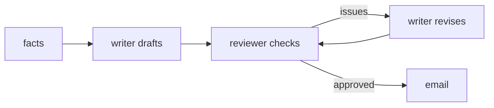

# Writer and reviewer

A writer drafts a customer email, a reviewer checks it against a style
guide, and the writer revises until the reviewer approves or the round limit
is reached. Separating the agent that writes from the agent that checks is a
simple way to raise quality, and the loop is ordinary Python: you can see
the stopping rule, bound the cost, and test it.



## The program

```python title="review_loop.py"
from pydantic import BaseModel

from lllm import Prompt, Tactic

GUIDE = """\
- Name the shutdown date.
- Link the migration guide.
- Never use internal system names."""

FACTS = """\
API v1 shuts down on 2027-03-31. Customers must move to API v2.
Migration guide: https://example.com/v2-migration
Internal note: the v1 gateway (gw-legacy) costs too much to run."""


class Review(BaseModel):
    approved: bool
    issues: list[str]


class Result(BaseModel):
    email: str
    approved: bool
    reviews: list[Review]


DRAFT = Prompt(
    path="notice/draft",
    prompt="Write a short email to customers about this change:\n{facts}",
)
REVISE = Prompt(
    path="notice/revise",
    prompt="Revise the email. Fix these issues:\n{issues}",
)
REVIEW = Prompt(
    path="notice/review",
    prompt="Review this customer email against the style guide.\n"
    "Style guide:\n{guide}\nEmail:\n{email}",
    format=Review,
)


class ReviewLoop(Tactic):
    name = "review_loop"
    agent_group = ["writer", "reviewer"]
    output_model = Result
    max_rounds = 3  # (1)!

    def call(self, facts: str) -> Result:
        writer, reviewer = self.agents["writer"], self.agents["reviewer"]
        writer.open("email")  # (2)!
        writer.receive_prompt(DRAFT, {"facts": facts})

        reviews = []
        for round_number in range(1, self.max_rounds + 1):
            email = writer.respond().content
            reviewer.open(f"review-{round_number}")  # (3)!
            args = {"guide": GUIDE, "email": email}
            reviewer.receive_prompt(REVIEW, args)
            review = Review.model_validate(reviewer.respond().parsed)
            reviews.append(review)
            if review.approved:
                break
            issues = "\n".join(f"- {issue}" for issue in review.issues)
            writer.receive_prompt(REVISE, {"issues": issues})  # (4)!

        approved = review.approved
        return Result(email=email, approved=approved, reviews=reviews)


review_loop = ReviewLoop(
    {
        "global": {"model_name": "gpt-4o-mini"},
        "agent_configs": [
            {"name": "writer", "system_prompt": "You write emails."},
            {"name": "reviewer", "system_prompt": "You check style."},
        ],
    }
)

if __name__ == "__main__":
    session = review_loop(FACTS, return_session=True)
    result = session.delivery
    print(result.approved, len(result.reviews))
    #> True 2
    print("\n".join(result.reviews[0].issues))  # (5)!
    """
    Uses the internal name gw-legacy; customers do not know it.
    Does not link the migration guide.
    """
    print(result.email)
    """
    Subject: API v1 retires on March 31, 2027

    Hello,

    API v1 will stop working on March 31, 2027. Please move to API v2 before
    then. The migration guide walks through each change:
    https://example.com/v2-migration

    Thanks,
    The Platform team
    """

    runs = session.agent_sessions
    print({name: len(calls) for name, calls in runs.items()})
    #> {'writer': 2, 'reviewer': 2}
```

1. The round limit bounds the cost. When it runs out, the result says
   `approved=False`, and the caller decides what to do, such as sending the
   draft to a person.
2. The writer keeps one dialog for the whole loop, so it sees its earlier
   drafts and every round of feedback, and revises instead of starting over.
3. The reviewer opens a fresh dialog for each draft, so it judges every
   draft on its own, without being anchored by the ones it already saw.
4. The feedback goes into the writer's dialog as a new turn. The next
   `respond()` produces the revision.
5. What the reviewer asked for in the first round.

## How it works

**Two agents, two kinds of memory.** The writer accumulates context: the
facts, its drafts, and the feedback. The reviewer is stateless by design:
each review starts from the style guide and one email. Choosing which agent
remembers is a decision about [dialogs](../dialogs.md), and LLLM makes it
explicit with `open()`.

**The review is data.** `format=Review` asks for JSON with `approved` and
`issues`, and the agent repairs replies that do not match. The loop
condition is `review.approved`, a boolean, not a guess about what the
reviewer's prose meant.

**The style guide lives with the reviewer.** The writer learns the rules
from feedback, which keeps its prompt focused on the facts. If first drafts
should already follow the guide, add it to the writer's system prompt too;
the reviewer still checks.

**The whole loop is one call.** The session records every writer and
reviewer call, two of each here, with their cost. The reviews are part of
the result, so a caller can see why a draft was approved.

## Make it yours

- Use a different model for the reviewer: give its agent config its own
  `model_name` ([Configuration](../configuration.md)).
- Ask for drafts in several tones by [forking](../dialogs.md#forking) the
  writer's dialog after the first draft and reviewing each branch.
- Stop early on hard failures: raise from `call()` when the reviewer flags
  something no revision can fix, such as missing facts.
- Run many emails at once with `review_loop.bcall([...])`; each gets its own
  writer and reviewer.
