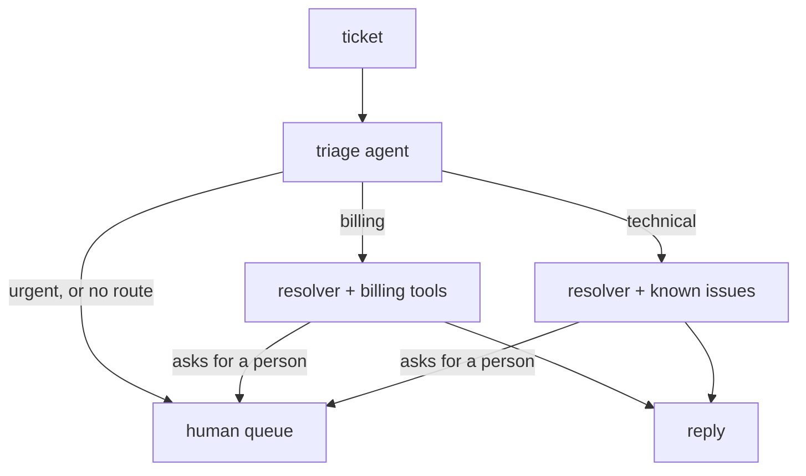

# Support triage

A support desk that sorts incoming tickets, resolves routine ones with
tools, and hands the rest to a person. A triage agent labels each ticket, a
resolver agent works it with the tools for its category, and plain Python
decides when to escalate. The rules that must always hold, such as the
refund limit and the escalation policy, live in code, so they hold even when
a model ignores its instructions.



## The program

```python title="support_triage.py"
from typing import Literal

from pydantic import BaseModel

from lllm import DefaultTagParser, Prompt, Tactic, tool

INVOICES = {"ana": [30.0, 30.0], "lee": [240.0]}
KNOWN_ISSUES = {"export": "KI-7: CSV exports over 10 MB fail. Fix: Friday."}
HUMAN_QUEUE = []


class Ticket(BaseModel):
    id: str
    customer: str
    text: str


class Outcome(BaseModel):
    ticket: str
    category: str
    action: Literal["resolved", "escalated"]
    reply: str


@tool(description="List a customer's recent invoice amounts")
def get_invoices(customer: str) -> list[float]:
    return INVOICES.get(customer, [])


@tool(description="Refund an amount to a customer")
def issue_refund(customer: str, amount: float) -> str:
    if amount > 100:  # (1)!
        raise ValueError("refunds over $100 need approval")
    return f"Refunded ${amount:.2f} to {customer}."


@tool(description="Look up a known issue by keyword")
def search_known_issues(keyword: str) -> str:
    return KNOWN_ISSUES.get(keyword.lower(), "No known issue.")


TRIAGE = Prompt(
    path="support/triage",
    prompt="Sort this support ticket.\nTicket: {text}\n"
    "Answer with <category>billing, technical, or account</category> "
    "and <urgency>low or high</urgency>.",
    parser=DefaultTagParser(required_xml_tags=["category", "urgency"]),
)
REPLY = DefaultTagParser(
    required_xml_tags=["reply"], signal_tags=["ESCALATE"]
)
INSTRUCTIONS = (
    "Write your answer to the customer in <reply></reply>. "
    "Add <ESCALATE> if a person must take over."
)
ROUTES = {  # (2)!
    "billing": Prompt(
        path="support/billing",
        prompt="Resolve this billing ticket from {customer}: {text}\n"
        + INSTRUCTIONS,
        parser=REPLY,
        function_list=[get_invoices, issue_refund],
    ),
    "technical": Prompt(
        path="support/technical",
        prompt="Resolve this technical ticket from {customer}: {text}\n"
        + INSTRUCTIONS,
        parser=REPLY,
        function_list=[search_known_issues],
    ),
}


class SupportTriage(Tactic):
    name = "support_triage"
    agent_group = ["triager", "resolver"]
    input_model = Ticket
    output_model = Outcome

    def call(self, ticket: Ticket) -> Outcome:
        triager = self.agents["triager"]
        triager.open("triage")
        triager.receive_prompt(TRIAGE, {"text": ticket.text})
        tags = triager.respond().parsed["xml_tags"]  # (3)!
        category, urgency = tags["category"][0], tags["urgency"][0]

        if urgency == "high" or category not in ROUTES:  # (4)!
            reply = "A teammate will reply within the hour."
            return self.outcome(ticket, category, "escalated", reply)

        resolver = self.agents["resolver"]
        resolver.open("resolve")
        resolver.receive_prompt(ROUTES[category], ticket.model_dump())
        parsed = resolver.respond().parsed
        reply = parsed["xml_tags"]["reply"][0]
        escalate = parsed["signal_tags"]["ESCALATE"]
        action = "escalated" if escalate else "resolved"
        return self.outcome(ticket, category, action, reply)

    def outcome(self, ticket, category, action, reply) -> Outcome:
        if action == "escalated":
            HUMAN_QUEUE.append(ticket.id)
        return Outcome(
            ticket=ticket.id, category=category, action=action, reply=reply
        )


support = SupportTriage(
    {
        "global": {"model_name": "gpt-4o-mini"},
        "agent_configs": [
            {"name": "triager", "system_prompt": "You sort tickets."},
            {"name": "resolver", "system_prompt": "You resolve tickets."},
        ],
    }
)

tickets = [
    Ticket(id="T-1", customer="ana", text="Two $30 charges for March."),
    Ticket(id="T-2", customer="raj", text="CSV export fails."),
    Ticket(id="T-3", customer="lee", text="Please refund my $240 plan."),
    Ticket(id="T-4", customer="kim", text="Our whole team is locked out!"),
]
if __name__ == "__main__":
    sessions = support.bcall(tickets, return_sessions=True)  # (5)!
    for session in sessions:
        outcome = session.delivery
        row = f"{outcome.ticket} {outcome.category:<9} {outcome.action:<9}"
        print(row, outcome.reply)
        #> T-1 billing   resolved  Refunded the duplicate $30 charge.
        #> T-2 technical resolved  Known issue KI-7; a fix ships Friday.
        #> T-3 billing   escalated A teammate will approve the refund.
        #> T-4 account   escalated A teammate will reply within the hour.
    print("Human queue:", sorted(HUMAN_QUEUE))
    #> Human queue: ['T-3', 'T-4']

    resolver = sessions[2].agent_sessions["resolver"][0]  # (6)!
    refund = resolver.tool_calls[-1]
    print(refund.name, "->", refund.result_str)
    #> issue_refund -> Error: refunds over $100 need approval
```

1. The limit is enforced where the money moves. The model sees
   `Error: refunds over $100 need approval` as the tool's result and has to
   work with it; it cannot talk its way past it.
2. Each route is a prompt with its own tools, so the technical resolver
   cannot issue refunds, and the billing one never sees known issues.
3. `DefaultTagParser` requires both tags. A reply that misses one is sent
   back with the parse error, so `call()` only sees complete labels.
4. Escalation rules are plain branches: urgent tickets and categories with
   no route go straight to a person, without a resolver call.
5. `bcall()` works the tickets concurrently, each with fresh agents, so one
   customer's details never reach another's dialog. With
   `return_sessions=True` it returns each call's session, in input order.
6. Every tool call is recorded, with its arguments and result. Here is the
   refund that the limit stopped.

## How it works

**Triage is a labeling prompt.** Tags are easier for a model to get right
than JSON, and `required_xml_tags` makes them mandatory. The two labels are
strings the program branches on, so the rest of the flow is ordinary Python
you can read and test.

**Each route brings its own tools.** A prompt's `function_list` is offered
only while that prompt drives the turn ([Tools](../tools.md)). Adding a
route means adding a prompt and its tools to `ROUTES`.

**The model can ask for help, but code decides.** The resolver's parser
reads an optional `<ESCALATE>` signal tag. The program escalates when the
model asks, when the ticket is urgent, and when no route exists. The model
cannot skip a rule that lives in a branch or a tool.

**Batches stay isolated.** Every ticket is its own tactic call: fresh
agents, its own session, and an outcome validated against `Outcome`. Pass
`fail_fast=False` to `bcall()` and a ticket that fails comes back as its
exception, in place, so the batch finishes and you can escalate the failure
too.

## Make it yours

- Replace `INVOICES`, `issue_refund`, and `KNOWN_ISSUES` with calls to your
  billing system and issue tracker; the tactic does not change.
- Put the human queue behind a tool or an API call instead of a list.
- Keep the prompts in a [package](../packages.md) and the agents' models in
  [configuration](../configuration.md), so the support team can tune
  wording without touching code.
- Serve it with `lllm serve support_triage:support`; `/run` takes a
  `Ticket` and returns an `Outcome` ([Serving](../serving.md)). The
  `__main__` guard keeps the demo batch from running when `lllm serve`
  imports the file.
