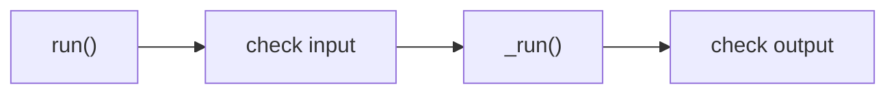

# Runtimes

A runtime is whatever does the work behind a tactic: LLLM's native agents,
plain Python, a Pydantic AI agent, or a service on another machine. All of
them implement one small protocol, `lllm.protocol.Tactic`, so the code that
calls, serves, packages, and composes tactics never needs to know which
runtime it has.

Here are three runtimes behind the same boundary, called by the same loop:

```python title="three_runtimes.py"
from pydantic_ai import Agent
from pydantic_ai.models.test import TestModel

from lllm import PydanticAITactic, Tactic, as_tactic

NOTE = "Deploys now pause when the error rate crosses two percent."


def word_count(text: str) -> int:  # (1)!
    """Count the words in a text."""
    return len(text.split())


class Headline(Tactic):  # (2)!
    """Write a headline for a note."""

    name = "headline"
    agent_group = ["editor"]
    input_type = str
    output_type = str

    def call(self, task: str) -> str:
        editor = self.agents["editor"]
        editor.open("headline")
        editor.receive(f"Write a headline for: {task}")
        return editor.respond().content


headline = Headline(
    {
        "global": {"model_name": "gpt-4o-mini"},
        "agent_configs": [{"name": "editor", "system_prompt": "You edit."}],
    }
)
tagger = Agent(TestModel(custom_output_text="reliability"), name="tagger")

for tactic in [as_tactic(word_count), headline, PydanticAITactic(tagger)]:
    info = tactic.info()  # (3)!
    print(f"{info.name}: {info.runtime_kind} -> {tactic.run(NOTE)!r}")
    #> word_count: python -> 10
    #> headline: native -> 'Deploys Pause When Errors Top 2%'
    #> tagger: pydantic-ai -> 'reliability'
```

1. A plain function. `as_tactic()` reads its types from the annotations and
   its description from the docstring.
2. A native program: `call()` runs an agent that is built fresh for every
   call.
3. Every tactic describes itself the same way. `runtime_kind` is the only
   field that says what runs inside.

The loop treats the three the same way, and so does the rest of LLLM:
`lllm serve` serves any of them, a [package](packages.md) lists any of them,
and `tactic_as_function()` hands any of them to an agent as a
[tool](tools.md#tactics-as-tools). Choosing a runtime is a decision about one
tactic, and you can change it later without touching its callers.

## The protocol

`lllm.protocol.Tactic` is a small generic class with no agent machinery. Its
public methods are the boundary:

| Method | Does |
| --- | --- |
| `run(value, *, context=None, return_trace=False, **kwargs)` | Validate the input, do the work, validate the output |
| `await arun(...)` | The same, async |
| `stream(value, ...)`, `astream(...)` | Yield chunks, for tactics that stream |
| `aevents(...)` | Yield `TacticEvent`s; a service's `/stream` sends these |
| `info()` | The contract: name, description, JSON schemas, capabilities, `runtime_kind` |
| `supports(name)`, `capabilities()` | What it can do, such as `stream` or `events` |

`run()` enforces the boundary, and a runtime fills in one step of it:



Validation uses the tactic's `input_type` and `output_type`: anything
Pydantic can validate, such as a model, `str`, or `list[str]`. Every call
carries a `CallContext` with ids for tracing and per-request metadata; one is
created when the caller passes none. [Typed I/O](typed-io.md) and
[Tactics](tactics.md) cover both from the caller's side.

LLLM ships these runtimes:

| Runtime | You write | `runtime_kind` |
| --- | --- | --- |
| Native | an `lllm.Tactic` subclass with a `call()` program | `native` |
| Plain Python | `as_tactic(fn)`, or an `lllm.Tactic` with a `_run()` hook | `python` |
| Pydantic AI | `PydanticAITactic(agent)` | `pydantic-ai` |
| Objects with `run()` or `call()` | `NativeTacticAdapter(obj)` | `native` |
| A service | `RemoteTactic(url)` | `http` |

Wrappers such as `ProxyTactic` (hooks and call records) and
`SandboxedTactic` (limits at the call boundary) take a tactic of any of these
kinds, because they only use the protocol.

## Plain functions

`as_tactic()` turns a function into a tactic. Types come from the
annotations, the name from the function, and the description from its
docstring:

```python title="quote.py"
from pydantic import BaseModel

from lllm import CallContext, as_tactic


class Order(BaseModel):
    sku: str
    quantity: int


class Quote(BaseModel):
    sku: str
    total: float


def quote(order: Order, context: CallContext) -> Quote:
    """Price an order at 2.50 per unit."""
    print("trace:", context.trace_id)
    #> trace: t-1
    return Quote(sku=order.sku, total=order.quantity * 2.5)


tactic = as_tactic(quote)
order = {"sku": "A-1", "quantity": 4}
print(repr(tactic.run(order, context=CallContext(trace_id="t-1"))))
#> Quote(sku='A-1', total=10.0)
print(tactic.info().name, "|", tactic.info().description)
#> quote | Price an order at 2.50 per unit.
```

- The input type is the first parameter's annotation (a parameter named
  `context` is skipped), and the output type is the return annotation.
  `input_type=` and `output_type=` override them.
- A function with a `context` parameter, or `**kwargs`, receives the
  `CallContext`. Extra keyword arguments to `run()` are passed through.
- Async functions work with `arun()` and `run()`. `run()` drives them with
  `asyncio.run()`, so inside a running event loop, use `arun()`.
- `as_tactic()` also takes `name`, `description`, `package_ref`,
  `service_ref`, `examples`, and `metadata`, and returns a `CallableTactic`.

## The native runtime

`lllm.Tactic`, the class the rest of this guide uses, is the native
runtime's program class, and it subclasses `lllm.protocol.Tactic`. There is
no adapter step: the class you write is the one that is served, packaged,
and handed to other runtimes. A class that writes `call()` is a native
program: each call runs on a fresh copy with fresh agents, inside a session
that records agent calls and cost. A subclass that implements only the
protocol hook `_run()` reports `python`. See [Tactics](tactics.md).

## Pydantic AI

`PydanticAITactic(agent)` wraps a Pydantic AI agent: `run()` calls the
agent's `run_sync()`, `arun()` calls `run()`, `stream()` uses
`run_stream_sync()`, and `aevents()` uses `run_stream_events()`. Its options,
and giving LLLM tactics to Pydantic AI agents as tools, are on
[Pydantic AI](pydantic-ai.md).

## Objects with `run()` or `call()`

Code you already have may not be a tactic but have the right shape: a
`run()` or `call()` method, and maybe `arun()`, `acall()`, or `stream()`.
`NativeTacticAdapter` puts the boundary around it without changing it:

```python title="adapter.py"
from lllm import CallContext, NativeTacticAdapter


class KeywordTagger:
    """Tag a text with words from a fixed vocabulary."""

    name = "keyword-tagger"
    input_type = str
    output_type = list[str]

    def __init__(self, vocabulary):
        self.vocabulary = vocabulary

    def run(self, text, *, limit=3, metadata=None):
        print("trace:", metadata["lllm_trace_id"])
        #> trace: t-2
        words = text.lower().replace(".", "").split()
        return [word for word in self.vocabulary if word in words][:limit]


tagger = NativeTacticAdapter(
    KeywordTagger(["deploys", "errors", "latency", "rollback"]),
    run_kwargs={"limit": 2},  # (1)!
)
note = "Rollback deploys when errors spike."
print(tagger.run(note, context=CallContext(trace_id="t-2")))
#> ['deploys', 'errors']
print(tagger.info().name, "|", tagger.info().description)
#> keyword-tagger | Tag a text with words from a fixed vocabulary.
```

1. Added to every call. Keyword arguments to `run()` are merged over them.

The adapter calls `run()` if the object has one, else `call()`, and uses
`arun()` or `acall()` for async calls when they exist (otherwise a worker
thread). It takes the types from the object's `input_type` or `input_model`
and `output_type` or `output_model` unless you pass them, and the name and
description from its `name` and class docstring. A method that accepts
`context` gets the `CallContext`; one that accepts `metadata` gets the
context's metadata with `lllm_request_id`, `lllm_trace_id`, and the other ids
added (turn this off with `include_context_metadata=False`).

## Services

`RemoteTactic(url)` is a tactic backed by a served tactic: `run()` posts to
its `/run`, the stream methods read its `/stream`, and `fetch_info()` reads
its `/info`. Because it is a tactic, a remote service fits wherever a local
one does, including as an agent's tool. See [Serving](serving.md) and the
[HTTP service example](examples/http-service.md).

## Writing a runtime adapter

To bring another runtime to LLLM, subclass `lllm.protocol.Tactic` and
implement the hooks it needs. Here is a complete adapter for objects with
`invoke()` and `stream()` methods:

```python title="invoke_adapter.py"
import asyncio
import inspect
from typing import Any

from lllm.protocol import Tactic


class InvokeTactic(Tactic[Any, Any]):
    runtime_kind = "invoke"  # (1)!

    def __init__(
        self, runnable, *, input_type=None, output_type=None, **kwargs
    ):
        self.runnable = runnable
        self.input_type = input_type
        self.output_type = output_type
        kwargs.setdefault("description", inspect.getdoc(type(runnable)))
        super().__init__(**kwargs)  # (2)!

    def _run(self, input_value, *, context=None, **kwargs):  # (3)!
        return self.runnable.invoke(input_value, **kwargs)

    def stream(self, input_value, *, context=None, **kwargs):  # (4)!
        yield from self.runnable.stream(input_value, **kwargs)


class Sentences:
    """Split a text into sentences."""

    def invoke(self, text):
        parts = [part.strip() for part in text.split(".")]
        return [f"{part}." for part in parts if part]

    def stream(self, text):
        yield from self.invoke(text)


tactic = InvokeTactic(
    Sentences(), name="sentences", input_type=str, output_type=list[str]
)
info = tactic.info()
print(info.name, info.runtime_kind, info.capabilities)
#> sentences invoke ('arun', 'run', 'stream')
print(info.description)
#> Split a text into sentences.
print(tactic.run("Deploys pause. Alerts fire."))
#> ['Deploys pause.', 'Alerts fire.']


async def main():
    async for event in tactic.aevents("Deploys pause. Alerts fire."):
        print(event.kind, event.data)
        #> message Deploys pause.
        #> message Alerts fire.


asyncio.run(main())
```

1. A short label, shown in `info()`, `/info`, and on hub cards.
2. Pass `name`, `description`, `package_ref`, `service_ref`, `examples`, and
   `metadata` through to the base class.
3. `_run()` receives the validated input and the call's `CallContext`.
   Return anything that validates into `output_type`.
4. Writing `stream()` adds the `stream` capability. `astream()` and
   `aevents()` come for free: they validate the input, then run `stream()`
   on a worker thread.

| Hook | Write it when | Default |
| --- | --- | --- |
| `_run()` | always, unless you write `_arun()` | raises `TacticUnsupportedError` |
| `_arun()` | the runtime is natively async | runs `_run()` on a worker thread |
| `stream()` | the runtime can stream | raises `TacticUnsupportedError` |
| `astream()` | its stream is natively async | runs `stream()` on a worker thread |
| `aevents()` | it has its own event kinds | wraps each chunk as `TacticEvent(kind="message")` |
| `capabilities()` | support depends on the wrapped object | derived from the methods you override |
| `info()` | the runtime knows more, such as an output schema | built from the class and constructor |

Calling `stream()` directly skips input validation, so callers that start
from raw data should use `astream()` or `aevents()`, as services do.

## How entrypoints become tactics

`lllm serve module:attribute` accepts more than a tactic. It passes the
value to `coerce_tactic()` (from `lllm.runtimes`), which accepts, in order:

1. a `Tactic` subclass, which it instantiates, or a `Tactic` instance;
2. a factory, which it calls once at load: a class that can be constructed
   without arguments, a function with no parameters, or a function that can
   be called without arguments and is annotated to return a tactic;
3. an object with a `run()` method, whose `run` it wraps with `as_tactic()`;
4. any other callable: a handler, wrapped with `as_tactic()` and called once
   per input.

```python title="entrypoints.py"
from lllm import CallableTactic, as_tactic
from lllm.runtimes import coerce_tactic


def greet(name: str = "world") -> str:
    return f"Hello {name}"


def make_greeter() -> CallableTactic:
    return as_tactic(greet, name="greeter")


print(coerce_tactic(greet).run("Ada"))
#> Hello Ada
print(coerce_tactic(make_greeter).info().name)
#> greeter
```

`greet` can be called without arguments too, but it is not annotated to
return a tactic, so it is a handler: it answers each input instead of being
called once at load.

## Choosing a runtime

- **Native** when you are building the agentic system itself: you want to
  see and steer every turn, parse and repair outputs, fork dialogs, and
  track agents and cost in sessions.
- **Plain Python** for deterministic steps such as parsing, scoring, and
  lookups, and for wrapping code that has nothing to do with agents.
- **Pydantic AI** when an agent is already written for Pydantic AI, or you
  want its model, tool, and instrumentation ecosystem.
- **Remote** when the work runs elsewhere: another team's service, a GPU
  host, or a process you scale separately.

The choice is local to one tactic. A native program can call a Pydantic AI
tactic, which can use a native tactic as a tool, and any of them can move
behind a service without its callers changing.
