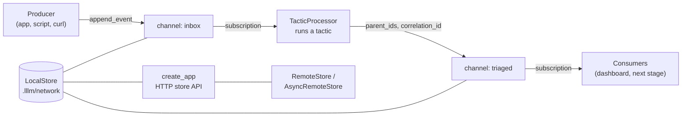

# SSSN: the network module

SSSN, the **Simple System of Systems Network**, connects systems through
channels. A channel is a named stream of records: producers append to it,
consumers read it at their own pace, and every record can point back at the
records it came from. A tactic is one system; channels are how its inputs
arrive and its outputs leave. In code, SSSN is `lllm.network`.

SSSN is an experimental module of LLLM.

```bash
pip install "lllm-core[server,client]"   # adds the FastAPI store server and the HTTP clients
```

The data model, `LocalStore`, and `TacticProcessor` need only `lllm-core`.

## Five resources

<div class="psi-tiles">
  <div class="psi-tile">
    <strong>Channel</strong>
    A named stream with a schema ref, a form, a description, and metadata.
  </div>
  <div class="psi-tile">
    <strong>Event</strong>
    One append-only record in a channel: payload, kind, source, correlation id,
    and parent event ids. The store assigns its cursor.
  </div>
  <div class="psi-tile">
    <strong>Subscription</strong>
    A named cursor over one channel, kept in the store so a consumer can stop
    and resume.
  </div>
  <div class="psi-tile">
    <strong>Artifact</strong>
    Bytes stored by reference, with a media type and links to the events they
    belong to.
  </div>
  <div class="psi-tile">
    <strong>Snapshot</strong>
    The latest value under a name, optionally pointing at the event that
    produced it.
  </div>
</div>

All five are Pydantic models exported from `lllm.network`, and every store
(`LocalStore`, `RemoteStore`, `AsyncRemoteStore`) reads and writes them with the
same method names.

## A channel in ten lines

```python
from lllm.network import Channel, Event, LocalStore

store = LocalStore(".lllm/network")
store.create_channel(Channel(name="inbox", description="Support messages."))

store.append_event(Event(channel="inbox", kind="message", payload={"text": "Checkout is down"}))
store.append_event(Event(channel="inbox", kind="message", payload={"text": "How do I export data?"}))

for event in store.query_events("inbox"):
    print(event.cursor, event.payload["text"])
```

```text
1 Checkout is down
2 How do I export data?
```

`LocalStore` keeps a whole store in one folder: SQLite for channels, events,
subscriptions, and snapshots, and plain files for artifact bytes. Serve that
folder with `lllm network serve` and any process can use it through
`RemoteStore`, which has the same methods.

## Tactics over channels

`TacticProcessor` joins the two halves of LLLM. It reads a channel through a
named subscription, runs each event's payload through a tactic, and appends the
output to a sink channel with a pointer back to the input. Continuing the
example:

```python
from lllm import as_tactic
from lllm.network import TacticProcessor


def triage(ticket: dict) -> dict:
    urgent = "down" in ticket["text"].lower().split()
    return {"priority": "urgent" if urgent else "normal"}


store.create_channel({"name": "triaged"})
processor = TacticProcessor(
    as_tactic(triage), store, source="inbox", sink="triaged", consumer="triage"
)

for result in processor.process():
    origin = store.get_event(result.parent_ids[0])
    print(result.payload, "<-", origin.payload["text"])
```

```text
{'priority': 'urgent'} <- Checkout is down
{'priority': 'normal'} <- How do I export data?
```

Call `processor.process()` again and it returns `[]`: the `triage`
subscription lives in the store and remembers where it stopped, across
restarts and across processes. Any tactic works here, including native tactics
with agents and remote tactics (see [The Tactic](../protocol/tactic.md)).
[Processing](processing.md) covers resuming, failures, async workers, and
multi-stage pipelines.

## How the pieces fit



| You want to | Use | Read |
| --- | --- | --- |
| Model channels, events, subscriptions, artifacts, snapshots | `Channel`, `Event`, `Subscription`, `Artifact`, `Snapshot` | [Channels and stores](channels.md) |
| Keep a store on disk | `LocalStore` | [Channels and stores](channels.md) |
| Run a tactic over a channel | `TacticProcessor` | [Processing](processing.md) |
| Serve a store over HTTP, add routes | `create_app`, `endpoint` | [Serving](serving.md) |
| Use a served store from another process | `RemoteStore`, `AsyncRemoteStore` | [Serving](serving.md) |
| Name channels with `lllm://` refs | `ChannelRef`, `ChannelResolver`, `lllm.Resolver` | [Serving](serving.md) |
| Work from the shell | `lllm network --store DIR <command>` | [Serving](serving.md#cli) |
| Mount channels next to tactics in one API | `lllm.shell` | [AAAX](../aaax/index.md) |

## Status

Names and wire formats may change between releases. Current limits worth
knowing before you build on it:

- One storage backend: `LocalStore` (SQLite plus files). The HTTP server and
  clients put any process in front of it.
- Consumers poll. There is no push delivery or blocking pull.
- A subscription's cursor moves when events are pulled, so delivery to a
  consumer is at most once. [Processing](processing.md#failures) shows how to
  keep failures visible.
- The store server has no authentication. Bind it to localhost or put it
  behind your own gateway.

## Next

- [Channels and stores](channels.md): every resource and the `LocalStore`
  layout.
- [Processing](processing.md): `TacticProcessor` in depth and pipelines.
- [Serving](serving.md): the store server, clients, refs, and the CLI.
- [Tutorial 11: Channels with SSSN](../tutorials/11-channels.md): build a small
  system end to end.
