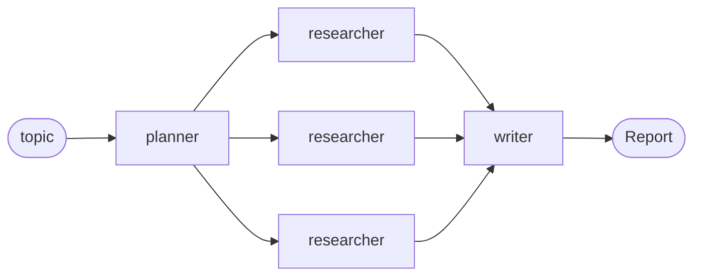

# Tactics

A tactic is the program of an agentic system. You subclass `Tactic`, name
the agents it uses, and write `call()`: ordinary Python that decides what to
ask each agent, in what order, and what to do with the answers. Agents are
built fresh from config for every call, so a tactic keeps no state between
calls and can run many calls at once.

Here is a complete program. A planner splits a topic into questions, a
researcher answers them in parallel, and a writer turns the findings into a
typed report:



```python title="report.py"
from pydantic import BaseModel

from lllm import Prompt, Tactic


class Plan(BaseModel):
    questions: list[str]


class Report(BaseModel):
    title: str
    points: list[str]


PLAN = Prompt(
    path="report/plan",
    prompt="List three questions to research about {topic}.",
    format=Plan,
)
ANSWER = Prompt(
    path="report/answer", prompt="Answer in one sentence: {question}"
)
WRITE = Prompt(
    path="report/write",
    prompt="Write a report on {topic}, one point per finding:\n{findings}",
    format=Report,
)


class Research(Tactic):  # (1)!
    """Answer one research question."""

    name = "research"
    agent_group = ["researcher"]

    def call(self, question: str) -> str:
        researcher = self.agents["researcher"]
        researcher.open("answer")
        researcher.receive_prompt(ANSWER, {"question": question})
        return researcher.respond().content


class ReportWriter(Tactic):
    """Plan, research in parallel, and write a short report."""

    name = "report"
    agent_group = ["planner", "writer"]  # (2)!
    output_model = Report

    def __init__(self, config):
        super().__init__(config)
        self.research = Research(config)  # (3)!

    def call(self, topic: str) -> Report:  # (4)!
        planner = self.agents["planner"]
        planner.open("plan")
        planner.receive_prompt(PLAN, {"topic": topic})
        plan = Plan.model_validate(planner.respond().parsed)

        findings = self.research.bcall(plan.questions)  # (5)!

        writer = self.agents["writer"]
        writer.open("write")
        notes = "\n".join(findings)
        writer.receive_prompt(WRITE, {"topic": topic, "findings": notes})
        return writer.respond().parsed  # (6)!


config = {
    "global": {"model_name": "gpt-4o-mini"},  # (7)!
    "agent_configs": [
        {"name": "planner", "system_prompt": "You plan research."},
        {"name": "researcher", "system_prompt": "You answer questions."},
        {"name": "writer", "system_prompt": "You write short reports."},
    ],
}
report = ReportWriter(config)

result = report("heat pumps")
print(result.title)
#> Heat pumps in three points
print("\n".join(f"- {point}" for point in result.points))
"""
- They move heat instead of burning fuel, so they give more than they use.
- Cold-climate models keep heating down to about -25°C.
- Each unit of electricity yields 2.5 to 4 units of heat.
"""

session = report("heat pumps", return_session=True)  # (8)!
print(session.agent_call_count, session.sub_tactic_call_count)
#> 2 3
print(f"${session.total_cost.cost:.4f}")
#> $0.0001
```

1. A tactic can be one small step. `Research` answers a single question
   with one agent, and `ReportWriter` uses it as a building block.
2. `agent_group` names the agents this tactic uses. Each is described in
   the config, and every call gets fresh ones in `self.agents`.
3. A tactic stored on an attribute is a sub-tactic. Its calls run on agents
   of their own and are recorded in the caller's session.
4. `call()` is the program: plain Python that you can step through in a
   debugger. It receives the input and returns the result.
5. `bcall` runs `Research` on all three questions at once, in threads. Each
   call gets its own researcher, and the answers come back in input order.
6. `parsed` holds the writer's JSON as a dict. Because the tactic declares
   `output_model = Report`, the dict is validated into a `Report` on the way
   out ([Typed I/O](typed-io.md)).
7. Models are configuration. Change this line to move every agent to
   another model, or give one agent its own `model_name`.
8. The tactic runs again and opens `plan` and `write` anew, because every
   call gets fresh agents. `return_session=True` returns the call's record:
   2 calls by its own agents, 3 sub-tactic calls, and the cost of all five.

Nothing here is a framework construct. The fan-out is one method call, and
a loop, a retry, or a branch on the planner's answer would be ordinary Python
too.

## Writing a tactic

A tactic class sets a few attributes and writes `call()`:

| Attribute | Purpose |
| --- | --- |
| `name` | The tactic's name in sessions, logs, packages, and services; defaults to the class name |
| `agent_group` | The agents `call()` uses; each needs an entry in the config |
| `input_model`, `output_model` | Optional types for the input and the result ([Typed I/O](typed-io.md)) |
| docstring | The description that `info()` publishes and tool wrappers show the model |

Every call runs on a copy of the tactic. The copy builds fresh agents from
the config, validates the input, runs `call()`, validates the result, and
records the outcome in a [session](#sessions). A tactic without
`agent_group` is a tactic too: its `call()` can run deterministic steps or
call other tactics, and it is typed, recorded, and served the same way.

Tactics call tactics like functions. Store one on an attribute in
`__init__` (it is listed in `sub_tactics`) and call it with any entry point;
each sub-call gets its own agents, and its session and cost roll up into the
caller's. A subclass can extend a program: add an agent to `agent_group`
and call `super().call(task)` to reuse the parent's steps.

## Describing agents in config

The constructor takes the config: a dict, as above, or YAML from a
project's config files ([Configuration](configuration.md)). `global` holds
defaults that are merged into every entry of `agent_configs`; nested
settings such as `model_args` merge key by key, and the agent's own values
win:

```yaml
global:
  model_name: gpt-4o-mini
  model_args:
    temperature: 0.2
agent_configs:
  - name: planner
    system_prompt: You plan research.
  - name: researcher
    system_prompt_path: research/system   # a registered prompt
    max_interrupt_steps: 8
  - name: writer
    model_name: gpt-4o                    # this agent only
    system_prompt: You write short reports.
```

| Key | Meaning |
| --- | --- |
| `name` | Matches a name in `agent_group` |
| `model_name` | Any [LiteLLM model](models.md); required, often set under `global` |
| `system_prompt`, `system_prompt_path` | Inline text, or the path of a registered [prompt](prompts.md) |
| `model_args` | Settings sent with every call, such as `temperature` |
| `max_interrupt_steps`, `max_exception_retry`, `max_llm_recall`, `max_rate_limit_retries` | [Loop limits](agents.md#the-agent-loop) |
| `tools`, `proxy`, `skills` | Capabilities offered on every turn ([Tools](tools.md), [Proxies](proxies.md)) |
| `context_manager` | Trims long conversations ([Dialogs](dialogs.md#long-conversations)) |
| `inference_hints` | Hints for KV-cache-aware servers ([Inference hints](inference-hints.md)) |
| `api_type` | `completion` (default) or `response` |

Unknown keys are sent to the model as `model_args`, with a warning that
lists the known keys. Entries for agents outside `agent_group` are ignored,
so one config can serve several tactics, as `Research` and `ReportWriter`
share one above. A missing agent, model name, or system prompt raises when
the tactic is built, before any model call. At the top level, `max_workers`
sets how many threads `bcall` and `ccall` use (4 by default).

## Fresh agents for every call

Each call builds its agents from the config, so nothing carries over from
one call to the next:

```python title="fresh.py"
from lllm import Tactic


class Assistant(Tactic):
    name = "assistant"
    agent_group = ["assistant"]

    def call(self, message: str) -> str:
        assistant = self.agents["assistant"]
        assistant.open("chat")  # (1)!
        assistant.receive(message)
        return assistant.respond().content


config = {
    "global": {"model_name": "gpt-4o-mini"},
    "agent_configs": [{"name": "assistant", "system_prompt": "You help."}],
}
assistant = Assistant(config)
print(assistant("Remember this code: 4417."))
#> Got it: 4417.
print(assistant("What code did I give you?"))  # (2)!
#> You haven't given me a code yet.
```

1. Every call opens `chat` on a new agent, so it never collides with an
   earlier call's dialog.
2. The second call has its own agent and dialog. Nothing from the first
   call is there.

A call sees only its input and the config. That is what makes it safe to
run calls in parallel threads, in batches, or as concurrent requests to a
service, without locks. The costly parts (the model client, the registry,
the prompts) are shared, and only the agents and their dialogs are new. To
continue a conversation, keep it inside one call, or pass what the next call
needs in its input.

## Calling a tactic

| Call | Returns |
| --- | --- |
| `tactic(x)` | The result; with `return_session=True`, the [session](#sessions) |
| `await tactic.acall(x)` | The same, from async code |
| `tactic.bcall(xs, max_workers=None, fail_fast=True)` | Results in input order; with `fail_fast=False`, a failed call's exception takes its place |
| `async for i, result in tactic.ccall(xs)` | `(index, result)` pairs, as each call finishes |
| `tactic.run(x)`, `await tactic.arun(x)` | The result, through the boundary that [services](serving.md) and other runtimes use; `return_trace=True` returns a `CallResult` with timing and any error |

Every form validates the input and the result in the same way, and runs
`call()` on fresh agents:

```python title="calls.py"
import asyncio

from lllm import Tactic


class Sentiment(Tactic):
    """Label a product review as positive or negative."""

    name = "sentiment"
    agent_group = ["labeler"]

    def call(self, review: str) -> str:
        labeler = self.agents["labeler"]
        labeler.open("label")
        labeler.receive(
            f"Label this product review as positive or negative: {review}"
        )
        return labeler.respond().content


config = {
    "global": {"model_name": "gpt-4o-mini"},
    "agent_configs": [
        {"name": "labeler", "system_prompt": "Answer with one word."}
    ],
}
sentiment = Sentiment(config)
reviews = ["Works great.", "Broke in a week.", "Love the battery."]

print(sentiment("Arrived late."))
#> negative
print(sentiment.bcall(reviews))
#> ['positive', 'negative', 'positive']


async def main():
    print(await sentiment.acall("Great value."))
    #> positive
    labels = [None] * len(reviews)
    async for index, label in sentiment.ccall(reviews):  # (1)!
        labels[index] = label
    print(labels)
    #> ['positive', 'negative', 'positive']


asyncio.run(main())
```

1. `ccall` yields each result as soon as it is ready, which is not always
   input order, so every result comes with its index.

`call()` can also be `async def`. The async entry points (`acall`, `arun`,
`ccall`, and services) await it on the event loop, so it should call agents
with `await agent.arespond()` and sub-tactics with `await sub.acall(x)`;
the sync entry points run it to completion. Extra keyword arguments, as in
`tactic(x, tone="formal")`, are passed to `call()`. They are not part of the
typed input, so a service cannot send them; put anything a caller controls
in the input model. A `call()` that declares a `context` parameter receives
the request's `CallContext` (request id, trace id, tags, and metadata) when
it runs through `run()`, `arun()`, or a service.

## Sessions

Every call records a `TacticCallSession`. Sub-tactic calls roll up into it,
failures included, so the caller's session is the full record of a run:

```python title="sessions.py"
from lllm import Tactic


class Sentiment(Tactic):
    name = "sentiment"
    agent_group = ["labeler"]

    def call(self, review: str) -> str:
        if not review.strip():
            raise ValueError("empty review")
        labeler = self.agents["labeler"]
        labeler.open("label")
        labeler.receive(
            f"Label this product review as positive or negative: {review}"
        )
        return labeler.respond().content


class Digest(Tactic):
    """Count the positive reviews."""

    name = "digest"

    def __init__(self, config):
        super().__init__(config)
        self.sentiment = Sentiment(config)

    def call(self, reviews: list[str]) -> int:
        labels = self.sentiment.bcall(reviews, fail_fast=False)
        return labels.count("positive")


config = {
    "global": {"model_name": "gpt-4o-mini"},
    "agent_configs": [
        {"name": "labeler", "system_prompt": "Answer with one word."}
    ],
}
digest = Digest(config)
reviews = ["Works great.", "", "Broke in a week.", "Love it."]
session = digest(reviews, return_session=True)

print(session.state, session.delivery)
#> success 2
print(session.agent_call_count, session.sub_tactic_call_count)  # (1)!
#> 0 4
calls = session.sub_tactic_sessions["sentiment"]
print([call.error for call in calls if call.state == "failure"])
#> ['ValueError: empty review']
print(f"${session.total_cost.cost:.6f}")  # (2)!
#> $0.000040
```

1. `Digest` has no agents of its own; all four calls went to `Sentiment`.
2. `total_cost` adds this tactic's agents and every sub-tactic, so it
   includes the three labels the model wrote.

| Field | Holds |
| --- | --- |
| `state` | `"success"`, `"failure"`, or `"cancelled"` (`"running"` during the call) |
| `delivery` | The result |
| `error`, `error_traceback` | The exception and traceback of a failed call |
| `agent_sessions` | Each agent's calls, by agent name: a list of [`AgentCallSession`](agents.md#responses), with repairs, tool calls, and cost |
| `sub_tactic_sessions` | The sessions of tactics called during this call, by tactic name |
| `total_cost` | `agent_cost` plus `sub_tactic_cost`, as an `InvokeCost` |
| `agent_call_count`, `sub_tactic_call_count` | How many of each |
| `summary()` | A small dict for logs |

A sub-tactic is recorded by its call, not by an attribute: any tactic
called while another one runs, from an attribute, a local variable, or a
`bcall` worker thread, lands in the caller's session. A failed call raises,
so `return_session=True` never returns a failed session; the caller's
session and [observers](observability.md) still record it. The
`session_name`, `tags`, and `metadata` arguments of `tactic(x)` are passed
to the observer for logging.

Agents and their dialogs last for one call. Each `AgentCallSession` keeps
the model's replies, but the session does not keep the dialogs; to keep
them, read them in `call()` or in an observer
([Dialogs](dialogs.md#dialogs-and-agents)).

## Tactics as tools

A program decides its own steps. To let a model decide when to run a
tactic, offer the tactic as a tool. `tactic_as_function()` builds a tool
whose name, description, and parameters come from the tactic's `name`,
docstring, and input schema:

```python test="skip" reason="fragment; see the Tools guide"
from lllm.runtimes.native import tactic_as_function

ANSWER = Prompt(
    path="desk/answer",
    prompt="Answer the reader's question: {question}",
    function_list=[tactic_as_function(Research(config))],
)
```

The model can now call `research` as often as it needs, and each call runs
the whole `Research` program, recorded in the caller's session. See
[Tactics as tools](tools.md#tactics-as-tools); for Pydantic AI agents, use
`tactic.as_tool()` ([Pydantic AI](pydantic-ai.md)).

## One agent: `Tactic.quick`

`Tactic.quick()` builds one agent with no config. With a question it returns
the reply, and without one it returns the agent
([Agents](agents.md#creating-agents)):

```python title="commit.py"
from lllm import Tactic

reply = Tactic.quick(
    "Write a commit message for: fix typo in README",
    system_prompt="You write git commits.",
    model="gpt-4o-mini",
)
print(reply.content)
#> docs: fix typo in README
```

It is the shortest way to ask a model something, but it is not a tactic: it
has no typed boundary, no session, and nothing to serve. When a job grows,
move the agent into a one-agent tactic like `Assistant` in
[Fresh agents for every call](#fresh-agents-for-every-call). Then it can be
called in batches, typed, tested, packaged, and served with `lllm serve`
([Serving](serving.md)).
