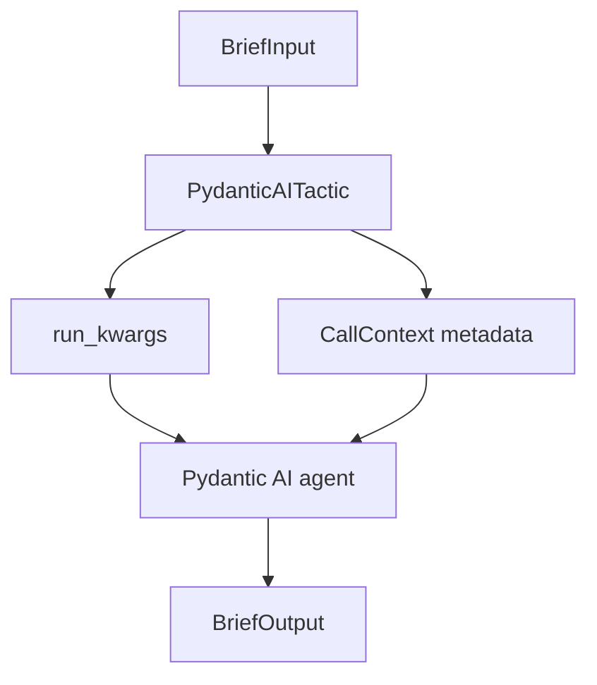

# 10. Pydantic AI Agents

**Goal:** wrap a Pydantic AI agent as an LLLM tactic, keep the runtime
features Pydantic AI owns, stream it, serve it over HTTP, package it, and hand
an LLLM tactic back to Pydantic AI as a tool.

`PydanticAITactic` puts a typed tactic boundary around a Pydantic AI agent. The
agent keeps owning models, tools, dependencies, model settings, streaming, and
instrumentation; the tactic adds validated Pydantic input and output, a
published contract, and the same `run`/`stream`/serve/package surface every
other tactic has.

Steps 1 to 9 use the offline stand-in agents in `examples/pydantic_ai_tactic/`.
They implement the parts of the Pydantic AI `Agent` interface the adapter calls
(`run_sync`, `run_stream_sync`, `output_json_schema`), so everything runs
without provider keys. Step 10 swaps in a real `pydantic_ai.Agent` driven by
Pydantic AI's offline `TestModel`.

## Prerequisites

A checkout of the LLLM repository, with the development and Pydantic AI extras:

```bash
python -m pip install -e ".[dev,pydantic-ai]"
```

Run the snippets from the repository root so `examples.` imports resolve.
[9. Serving and Composition](09-serving.md) covers serving in general;
[Runtimes](../protocol/runtimes.md#pydantic-ai) is the reference for
everything here.

Files used:

```text
examples/pydantic_ai_tactic/
  structured_agent.py      BriefInput, BriefOutput, FakeStructuredAgent, build_tactic
  surrounding_features.py  ConfiguredAgent, run_demo
tests/
  test_pydantic_ai_adapter.py
  test_examples.py
```

---

## Step 1: define typed I/O

The tactic's public contract is two Pydantic models. These are defined in
`examples/pydantic_ai_tactic/structured_agent.py`:

```python
from pydantic import BaseModel


class BriefInput(BaseModel):
    topic: str
    audience: str = "engineers"


class BriefOutput(BaseModel):
    title: str
    bullets: list[str]
    trace_id: str | None = None
```

They become the tactic's JSON schemas and are checked on every call. They
describe the tactic's contract; a real Pydantic AI agent still validates the
model's output against its own `output_type`.

Import them from the example module rather than redefining them. The tactic
checks the agent's output against the exact `BriefOutput` class, and the
stand-in agent returns the module's class:

```python
from examples.pydantic_ai_tactic.structured_agent import BriefInput, BriefOutput
```

## Step 2: wrap the agent

```python
from lllm import PydanticAITactic


def build_tactic(agent) -> PydanticAITactic:
    return PydanticAITactic(
        agent,
        name="brief-writer",
        input_type=BriefInput,
        output_type=BriefOutput,
        description="Write a short structured brief.",
        run_kwargs={"model_settings": {"temperature": 0}},
    )
```

`run_kwargs` are copied into every agent run. Use them for options Pydantic AI
owns (`model_settings`, `deps`, `usage_limits`, and so on) instead of turning
them into tactic fields. Pass `description=` too: it is what `/info`, `lllm
inspect`, and package cards show.



## Step 3: run it locally

```python
from lllm import CallContext
from examples.pydantic_ai_tactic.structured_agent import FakeStructuredAgent

agent = FakeStructuredAgent()
tactic = build_tactic(agent)

output = tactic.run(
    {"topic": "package refs", "audience": "robotics engineers"},
    context=CallContext(trace_id="trace-brief", metadata={"caller": "tutorial"}),
)
print(repr(output))
print(agent.last_metadata)

assert output.title == "Package Refs for robotics engineers"
assert output.trace_id == "trace-brief"
```

```text
BriefOutput(title='Package Refs for robotics engineers', bullets=['Define package refs', 'Make it useful for robotics engineers'], trace_id='trace-brief')
{'caller': 'tutorial', 'lllm_request_id': 'c86ee4e7-2e8a-4f6e-8d47-aaa31a7e4c91', 'lllm_trace_id': 'trace-brief'}
```

The input arrived as a dict, was validated into `BriefInput`, and reached the
agent as JSON text. Because the agent's `run_sync` accepts `metadata`, the
adapter forwarded the context's metadata with `lllm_request_id` and
`lllm_trace_id` added; the stand-in agent copies the trace id into its output.
An explicit `metadata=` argument to `run()` is never overwritten.

## Step 4: choose input and output modes

The default `input_mode="auto"` sends a model input as JSON text. Pick another
mode when your agent expects a different shape:

```python
dict_tactic = PydanticAITactic(
    agent,
    input_type=BriefInput,
    output_type=BriefOutput,
    input_mode="dict",
)
dict_tactic.run({"topic": "modes"})
print(agent.last_task)
```

```text
{'topic': 'modes', 'audience': 'engineers'}
```

| `input_mode` | The agent receives |
| --- | --- |
| `auto`, `json` | The model as JSON text. |
| `dict` | `model.model_dump(mode="json")`. |
| `python` | The model instance. |
| `text` | `str(value)`. |

By default the adapter returns `result.output`. `result_mode="result"` returns
the whole run result instead; declare `output_type=Any` with it, since the
result is not a `BriefOutput`:

```python
from typing import Any

result_tactic = PydanticAITactic(agent, input_type=BriefInput, output_type=Any, result_mode="result")
result = result_tactic.run({"topic": "modes"})
print(type(result).__name__, result.output.title)
```

```text
Result Modes for engineers
```

## Step 5: keep runtime-owned features

The surrounding-features example passes runtime-owned options through the
tactic: model settings and deps, stand-ins for an eval hook and a tool-approval
policy, and a durable run id and a graph node given at call time:

```python
from examples.pydantic_ai_tactic.surrounding_features import run_demo

output, configured = run_demo()
print(output)
print(configured.seen["kwargs"])

assert output["durable_run_id"] == "durable-1"
assert output["graph_node"] == "plan.step"
assert configured.seen["instrumented"] is True
```

```text
{'task': 'summarize package refs', 'model': 'fake-provider:small', 'instrumentation': ['logfire', 'opentelemetry'], 'trace_id': 'trace-surrounding', 'durable_run_id': 'durable-1', 'graph_node': 'plan.step'}
{'model_settings': {'temperature': 0}, 'deps': {'vector_store': 'fake'}, 'eval_hook': 'offline-score', 'tool_approval': 'runtime-owned', 'durable_run_id': 'durable-1', 'graph_node': 'plan.step'}
```

`run_kwargs` from the constructor and keyword arguments given to `run()` are
merged and handed to the agent unchanged. LLLM forwards them without
interpreting them, so with a real `pydantic_ai.Agent` use arguments its
`run_sync()` and `run()` accept, such as `model_settings`, `deps`, and
`usage_limits`.

## Step 6: stream

An agent with `run_stream_sync()` or `run_stream()` makes the tactic stream:

```python
print(tactic.info().capabilities)
print(list(tactic.stream(BriefInput(topic="refs"))))
```

```text
('arun', 'run', 'stream')
['topic:refs', 'audience:engineers']
```

The streaming methods hand the input to the agent as given, without the
validation `run()` applies. Pass a model instance, as above, so defaults such as
`audience` are filled in.

`stream_mode` picks the view of the stream result: `"output"` (the default)
reads `stream_output()`, `"text"` reads `stream_text()`, `"response"` reads
`stream_response()`, and `"raw"` yields the stream object itself:

```python
raw_tactic = PydanticAITactic(agent, stream_mode="raw")
print(list(raw_tactic.stream(BriefInput(topic="refs"))))
```

```text
[<examples.pydantic_ai_tactic.structured_agent.StreamResult object at 0x12ed39b28e00>]
```

When the agent has `run_stream_events()`, as a real `pydantic_ai.Agent` does,
`aevents()` yields Pydantic AI's own event objects.

## Step 7: serve it

The example module has a zero-argument factory, `build_tactic()`, that wraps a
fresh stand-in agent. Serve it:

```bash
lllm serve examples.pydantic_ai_tactic.structured_agent:build_tactic --port 8000
```

Call it with the same envelope every tactic uses:

```bash
curl -s -X POST http://127.0.0.1:8000/run \
  -H 'content-type: application/json' \
  -d '{"input":{"topic":"refs","audience":"engineers"},"context":{"trace_id":"trace-1"}}'
```

```json
{"output":{"title":"Refs for engineers","bullets":["Define refs","Make it useful for engineers"],"trace_id":"trace-1"},"request_id":"8f69d704-bcd7-4203-ba75-4ce26a4129e0","tactic":"brief-writer"}
```

The `trace_id` traveled from the request's context into the agent's metadata
and back out in the output. `/stream` sends events the same way; because
streaming skips validation (Step 6), send the complete input there, including
`audience`.

To test the app in-process, build it with `create_tactic_app`:

```python
from fastapi.testclient import TestClient
from lllm import create_tactic_app

client = TestClient(create_tactic_app(tactic))
response = client.post(
    "/run",
    json={"input": {"topic": "refs"}, "context": {"trace_id": "trace-1"}},
)
print(response.json()["output"])
print(client.get("/info").json()["description"])
```

```text
{'title': 'Refs for engineers', 'bullets': ['Define refs', 'Make it useful for engineers'], 'trace_id': 'trace-1'}
Write a short structured brief.
```

## Step 8: package it

A package makes the tactic discoverable, servable by path, and publishable to a
hub. Create a folder `brief-package/` with a factory module and a manifest.

`brief-package/brief_tactic.py`:

```python
from examples.pydantic_ai_tactic.structured_agent import (
    BriefInput,
    BriefOutput,
    FakeStructuredAgent,
)
from lllm import PydanticAITactic


def create_tactic() -> PydanticAITactic:
    return PydanticAITactic(
        FakeStructuredAgent(),
        name="brief-writer",
        input_type=BriefInput,
        output_type=BriefOutput,
        description="Write a short structured brief.",
    )
```

`brief-package/lllm.toml`:

```toml
[package]
org = "demo"
name = "brief"
version = "0.1.0"
primary = "tactics.brief"
description = "Structured briefs from a Pydantic AI agent."

[schemas.brief_input]
entry = "examples.pydantic_ai_tactic.structured_agent:BriefInput"

[schemas.brief_output]
entry = "examples.pydantic_ai_tactic.structured_agent:BriefOutput"

[tactics.brief]
entry = "brief_tactic:create_tactic"
input = "brief_input"
output = "brief_output"
runtime = "pydantic-ai"
description = "Write a short structured brief."
```

Validate it and see what `lllm serve` would launch:

```bash
lllm hub validate brief-package
lllm inspect brief-package
```

```text
warning: readme_missing: Package should include README.md.
warning: card_metadata_missing: Package should declare [card] metadata for generated cards.
ok
demo/brief:tactics.brief (tactic)
port: 8000
GET /health
GET /info
GET /tactics
GET /tactics/{name}/info
GET,HEAD /docs
GET,HEAD /docs/oauth2-redirect
GET,HEAD /openapi.json
GET,HEAD /redoc
POST /run
POST /stream
POST /tactics/{name}/run
POST /tactics/{name}/stream
```

The two warnings are about the hub card; add a `README.md` and a `[card]` table
before publishing. `lllm serve brief-package` now serves the primary tactic.
A package around a live agent declares its provider key, and `lllm serve`
checks for it before starting:

```toml
[requirements.api_keys]
OPENAI_API_KEY = "Model access for the brief writer."
```

Keys belong in the environment, `.env.local`, or the OS keyring
(`lllm setup brief-package`), never in the manifest.

## Step 9: expose a tactic as a tool

`tactic_as_tool` turns any tactic into a plain, typed function:

```python
import inspect
from lllm import tactic_as_tool

tool = tactic_as_tool(tactic, name="write_brief", parameter_mode="kwargs")
print(inspect.signature(tool))
print(repr(tool(topic="refs", audience="engineers")))
```

```text
(*, topic: str, audience: str = 'engineers') -> examples.pydantic_ai_tactic.structured_agent.BriefOutput
BriefOutput(title='Refs for engineers', bullets=['Define refs', 'Make it useful for engineers'], trace_id=None)
```

With `parameter_mode="kwargs"` the function takes one keyword per input field;
the default `"task"` mode takes the whole input as one `task` argument. Native
tactics have the same helper as a method, `tactic.as_tool()`.

!!! warning "Registering with a Pydantic AI agent"
    Pydantic AI reads tool parameter types from a function's annotations, which
    these generated functions do not set, so Pydantic AI 2.66 rejects a
    `"kwargs"` tool with a `KeyError` and sees a `"task"` tool's argument as
    untyped. To give a tactic to a Pydantic AI agent, register a small typed
    function instead, as in Step 10.

## Step 10: use a real Pydantic AI agent

`build_tactic` works unchanged with a real `pydantic_ai.Agent`. `TestModel`
keeps it offline by filling the output with placeholder values:

```python
from pydantic_ai import Agent
from pydantic_ai.models.test import TestModel

real_agent = Agent(TestModel(), output_type=BriefOutput, name="brief-writer")
real_tactic = build_tactic(real_agent)

print(repr(real_tactic.run({"topic": "package refs"})))
print(real_tactic.info().capabilities)
```

```text
BriefOutput(title='a', bullets=['a'], trace_id=None)
('arun', 'events', 'run', 'stream')
```

For live calls, give the agent a model name such as
`Agent("openai:gpt-4o-mini", output_type=BriefOutput)` and set
`OPENAI_API_KEY`.

Going the other way, a Pydantic AI agent can call an LLLM tactic through a typed
function. Pydantic AI derives the tool schema from the annotations and validates
the model's arguments into `BriefInput`:

```python
def write_brief(request: BriefInput) -> BriefOutput:
    """Write a short structured brief about a topic."""
    return tactic.run(request)


planner = Agent(TestModel(), tools=[write_brief])
print(planner.run_sync("Plan a talk about package refs.").output)
```

```text
{"write_brief":{"title":"A for engineers","bullets":["Define a","Make it useful for engineers"],"trace_id":null}}
```

`TestModel` called the tool with `topic="a"`, and the tactic filled in the
default audience. The same pattern hands any tactic to a Pydantic AI agent: a
native multi-agent program, a plain function, or a `RemoteTactic`.

---

## Verify

```bash
python -m pytest tests/test_pydantic_ai_adapter.py tests/test_examples.py
```

```text
........................................................................ [ 96%]
...                                                                      [100%]
75 passed in 0.54s
```

## Summary

| Concept | API |
| --- | --- |
| Wrap an agent | `PydanticAITactic(agent, input_type=..., output_type=..., description=...)` |
| Runtime options | `run_kwargs={...}` and keyword arguments to `run()` |
| Context | `run(..., context=CallContext(...))` reaches the agent as `metadata` |
| Input shape | `input_mode="auto"`, `"json"`, `"dict"`, `"python"`, or `"text"` |
| Full run result | `result_mode="result"` with `output_type=Any` |
| Stream | `tactic.stream(model_instance)`, `stream_mode=...` |
| Serve | `lllm serve module:factory`, `create_tactic_app(tactic)` |
| Package | `[tactics.NAME]` with `entry` and `runtime = "pydantic-ai"` |
| Tactic as a tool | a typed function over `tactic.run()`; `tactic_as_tool(tactic)` |

See [Runtimes](../protocol/runtimes.md) for the full adapter reference and
[Services](../protocol/services.md) for the HTTP contract.

**Next:** [11. Channels with SSSN](11-channels.md)
